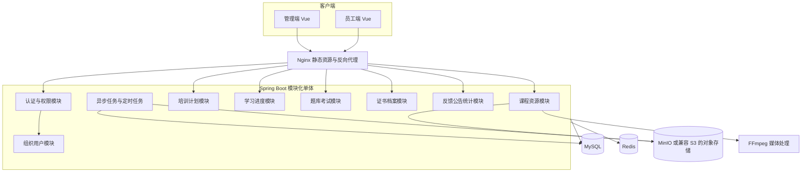
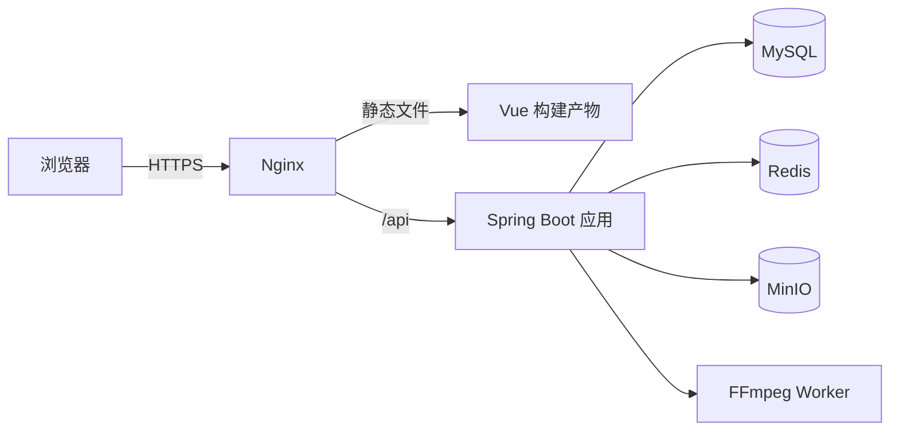
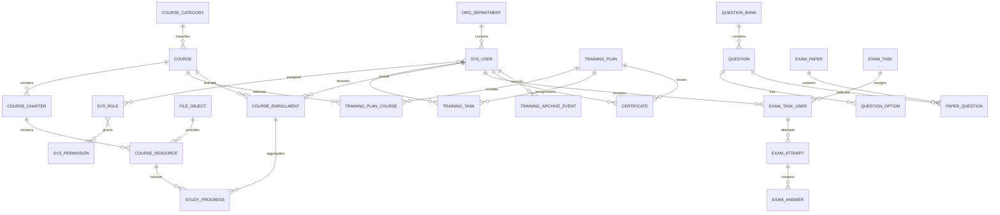
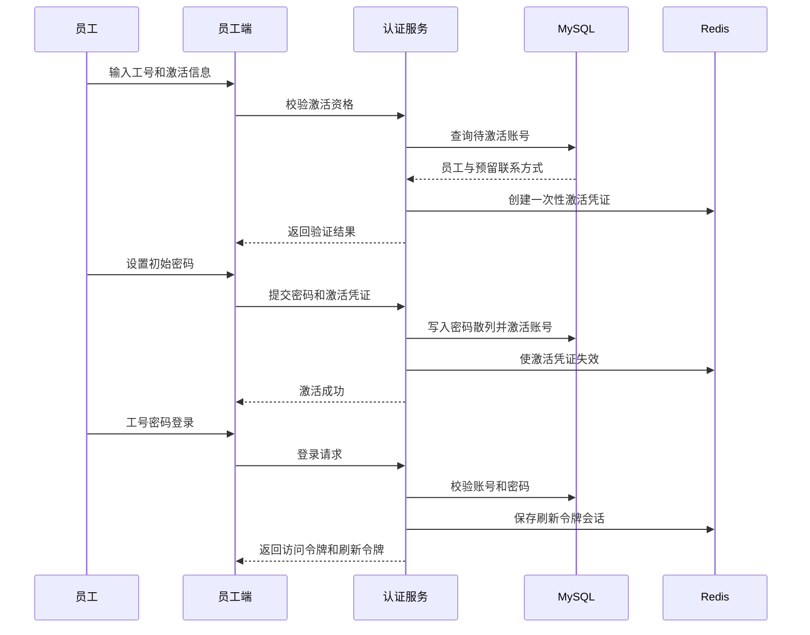
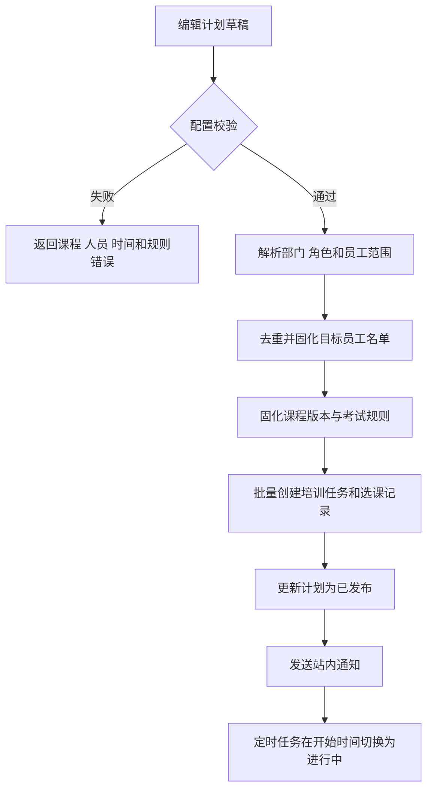
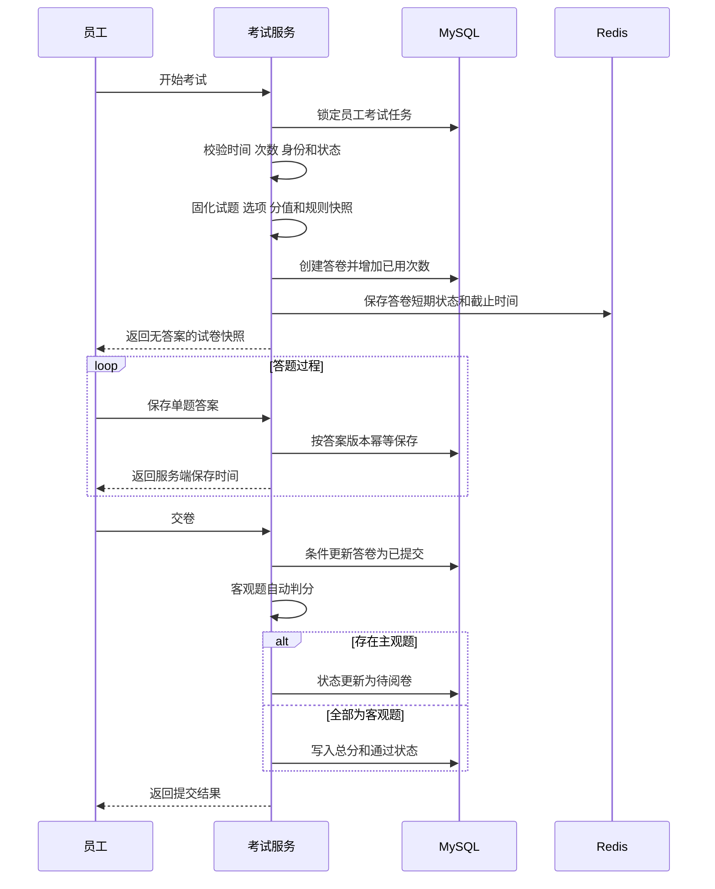
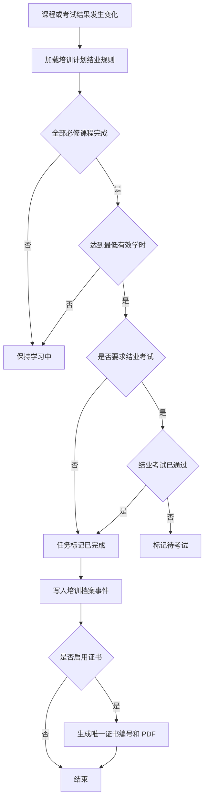

# 企业员工培训系统详细开发文档

> 文档类型：软件需求规格说明与系统设计说明
>
> 适用范围：企业员工端 Web 系统、培训管理端 Web 系统、统一后端服务
>
> 技术基线：Spring Boot、Vue、MySQL、ECharts
>
> 文档版本：V1.0
>
> 编制日期：2026 年 9 月 14 日

---

## 目录

1. 文档说明
2. 项目概述
3. 用户角色与权限范围
4. 功能需求
5. 非功能需求
6. 总体架构设计
7. 数据库设计
8. 接口设计
9. 核心业务流程设计
10. 前端设计
11. 后端实现设计
12. 数据统计设计
13. 安全设计
14. 日志监控与告警
15. 测试设计
16. 部署与运维设计
17. 开发规范
18. 项目实施计划
19. 验收标准
20. 项目风险与应对
21. 附录

---

## 1 文档说明

### 1.1 编写目的

本文档用于指导企业员工培训系统的需求确认、架构设计、数据库设计、接口开发、前端实现、测试、部署和验收。文档将题目要求拆分为可开发、可测试、可追踪的功能项，并明确关键业务规则和数据模型。

本系统采用前后端分离架构，为企业员工提供课程学习、培训任务、在线考试、练习、证书和个人培训档案服务；为企业人事及培训管理人员提供组织人员管理、课程资源管理、培训计划编排、题库与考试管理、学习监管、档案管理和数据分析能力。

### 1.2 目标读者

- 产品负责人和课题评审人员：确认业务范围及验收口径。
- 后端开发人员：根据领域模型、数据库和接口定义实现服务。
- 前端开发人员：根据页面结构、交互流程和接口契约实现员工端与管理端。
- 测试人员：根据业务规则、测试用例和非功能指标执行验证。
- 运维人员：根据部署拓扑、配置项和监控要求完成环境建设与运行保障。

### 1.3 文档范围

本文档覆盖以下内容：

1. 系统目标、角色、边界和约束。
2. 员工端与管理端的完整功能需求。
3. 总体架构、模块划分、权限模型和关键业务流程。
4. MySQL 数据模型、主要表结构和索引设计。
5. REST API、统一返回结构、错误码和幂等规则。
6. 学习进度、考试判分、证书生成、培训档案和统计分析设计。
7. 安全、性能、日志、测试、部署、备份和验收方案。

### 1.4 术语与缩写

| 术语 | 说明 |
| --- | --- |
| 员工端 | 普通员工使用的 Web 端，提供学习、考试、练习和个人中心功能 |
| 管理端 | 培训管理员、人事管理员和超级管理员使用的后台 Web 端 |
| 培训计划 | 面向指定部门或员工发布的一组课程、考试和完成要求 |
| 培训任务 | 培训计划发布后分配给单个员工的执行记录 |
| 必修课程 | 员工必须在截止日期前完成并达到规定学习条件的课程 |
| 学习进度 | 员工对课程章节和资源的完成度、播放位置及有效学习时长 |
| 考试任务 | 面向指定人员发布的线上考试安排 |
| 考试快照 | 员工开始考试时固化的题目、选项、分值与正确答案版本 |
| 电子培训档案 | 汇总员工培训任务、学习时长、考试成绩、证书等数据的电子记录 |
| RBAC | 基于角色的访问控制模型 |
| 数据权限 | 在功能权限之外，对可查看部门或员工数据范围的限制 |

---

## 2 项目概述

### 2.1 建设背景

企业培训涉及人员组织、课程资料、学习过程、考试结果、结业证明和统计分析。使用表格或分散工具管理时，容易出现课程版本不一致、学习过程无法核验、考试成绩分散、培训档案难以追溯等问题。本系统将培训业务集中到一个平台，并通过权限和数据范围控制保证不同角色只能处理其职责内的数据。

### 2.2 建设目标

- 为员工建立统一的在线学习入口，支持视频、PDF、PPT 等课程资源。
- 自动记录员工学习进度和有效学习时长，支持断点续播。
- 建立培训计划、课程、考试、结业证书之间的闭环。
- 为管理人员提供组织、人员、资源、计划、题库和考试的一体化管理功能。
- 自动形成可查询、可导出的员工电子培训档案。
- 使用 ECharts 展示部门完成率、考试通过率和培训参与情况。
- 建立身份认证、RBAC、数据权限、审计日志和文件访问保护机制。

### 2.3 系统边界

系统负责：

- 企业组织与员工培训账号管理。
- 培训课程、章节和学习资源管理。
- 培训计划和员工任务分配。
- 在线学习、学习进度、学习时长和课程完成判定。
- 题库、试卷、考试任务、答题、判分和错题解析。
- 评价、提问、反馈、公告、证书和培训档案。
- 培训数据统计、图表展示和报表导出。

系统暂不负责：

- 薪酬、考勤、绩效等完整人力资源管理业务。
- 视频直播、实时会议和在线课堂互动。
- 复杂的第三方单点登录；接口预留后可扩展企业统一身份认证。
- 收费课程、订单和支付业务。
- 多企业租户隔离；本期按照单企业部署设计。

### 2.4 用户规模与设计基线

以下指标作为项目默认设计和验收基线，可在实施前根据实际企业规模调整：

| 指标 | 设计值 |
| --- | ---: |
| 员工账号总量 | 5,000 个以内 |
| 日活跃用户 | 1,000 人以内 |
| 普通业务并发用户 | 300 人 |
| 同时参加考试人数 | 100 人 |
| 单课程章节数 | 不超过 200 个 |
| 单次导入员工数 | 不超过 5,000 条 |
| 单次导出记录数 | 前台同步不超过 10,000 条，超过后转异步任务 |
| 单视频文件 | 建议不超过 2 GB，支持分片上传 |
| 数据保留 | 核心培训档案长期保留，操作日志默认保留 180 天 |

---

## 3 用户角色与权限范围

### 3.1 角色定义

| 角色 | 主要职责 | 默认数据范围 |
| --- | --- | --- |
| 普通员工 | 学习课程、执行培训任务、参加考试、查看证书和档案、提交评价与反馈 | 仅本人数据及已授权公开资源 |
| 培训管理员 | 管理课程、资源、计划、题库、考试、证书和培训档案 | 授权部门及其下级部门 |
| 人事管理员 | 管理组织、员工账号、培训档案和人员报表 | 授权部门及其下级部门 |
| 超级管理员 | 管理角色、权限、系统配置、全部业务数据和审计日志 | 全部数据 |

说明：题目要求中的“培训管理员”在实现时可拆分为培训管理员、人事管理员和超级管理员，以满足最小权限原则。若课题演示希望简化，可将前两类权限授予同一个管理员账号。

### 3.2 权限模型

系统采用 RBAC 加数据权限的组合模型：

1. 用户通过角色获得菜单权限和操作权限。
2. 操作权限使用稳定编码，例如 `course:create`、`exam:publish`、`archive:export`。
3. 数据权限独立于菜单权限，支持本人、本部门、本部门及下级部门、自定义部门、全部数据五种范围。
4. 后端在服务层强制校验权限和数据范围，前端隐藏按钮只用于改善交互，不作为安全边界。
5. 高风险操作，如禁用账号、发布考试、撤销证书和批量导出，写入审计日志。

### 3.3 核心权限矩阵

| 功能 | 普通员工 | 培训管理员 | 人事管理员 | 超级管理员 |
| --- | :---: | :---: | :---: | :---: |
| 查看已发布课程 | 是 | 是 | 是 | 是 |
| 记录本人学习进度 | 是 | 否 | 否 | 否 |
| 参加本人考试 | 是 | 否 | 否 | 否 |
| 查看本人档案 | 是 | 否 | 否 | 是 |
| 课程与资源管理 | 否 | 是 | 可选 | 是 |
| 培训计划管理 | 否 | 是 | 可选 | 是 |
| 题库与考试管理 | 否 | 是 | 否 | 是 |
| 组织与员工管理 | 否 | 只读或受限 | 是 | 是 |
| 部门培训档案查询 | 否 | 是 | 是 | 是 |
| 角色和权限配置 | 否 | 否 | 否 | 是 |
| 系统审计日志 | 否 | 否 | 可选 | 是 |

---

## 4 功能需求

### 4.1 员工端功能

#### 4.1.1 注册激活与登录

**功能编号：FR-E-001**

系统使用工号作为企业内部员工的唯一登录标识。员工账号由管理员新增或批量导入，新员工首次使用时通过“账号激活”设置登录密码并确认个人信息。

主要功能：

- 工号和密码登录。
- 新员工账号激活。
- 图形验证码或滑块验证码。
- 忘记密码与密码重置。
- 登录失败次数限制和账号临时锁定。
- 修改头像、姓名展示信息、手机号、邮箱等个人资料。
- 修改密码和退出登录。
- 查看最近登录时间和异常登录提示。

业务规则：

1. 工号在企业范围内唯一，不允许员工自行创建不存在的工号。
2. 只有状态为“待激活”的员工账号可以走激活流程。
3. 激活校验可采用工号、预留手机号或邮箱、一次性激活码的组合。
4. 密码必须经过单向散列后存储，不保存明文密码。
5. 连续登录失败达到阈值后，账号锁定一段时间；管理员可手动解锁。
6. 被禁用或已离职账号不能登录，但历史培训档案仍保留。

#### 4.1.2 课程检索与学习

**功能编号：FR-E-002**

员工可以浏览已发布且自己有权访问的课程，并按课程分类、讲师、课程名称、必修状态和学习状态筛选。

主要功能：

- 课程列表、课程详情、章节目录和讲师信息展示。
- 按分类、讲师、关键词、难度、必修状态筛选。
- 在线播放视频，支持倍速播放、断点续播和清晰度切换。
- 在线预览 PDF；PPT 可转为 PDF 或图片后预览，并提供授权下载。
- 自动保存最后学习位置、章节完成状态和有效学习时长。
- 展示课程总进度、已学章节和剩余章节。
- 展示课程所属培训计划、截止日期和完成规则。

业务规则：

1. 课程处于“已发布”状态且员工满足可见范围时才可学习。
2. 课程进度按课程内必学资源权重计算；默认按必学资源数量等权计算。
3. 视频完成条件默认为有效观看进度达到视频总时长的 90%，阈值可按课程配置。
4. 文档资源打开并满足最短阅读时长后可标记完成；是否允许手动确认由课程配置。
5. 学习心跳必须携带资源、播放位置和本次连续播放时长，后端负责校验异常跳时。
6. 课程下架后不可新开始学习，但管理员可配置是否允许已分配任务的员工继续完成。

#### 4.1.3 学习记录与培训历史

**功能编号：FR-E-003**

主要功能：

- 查看全部课程学习记录。
- 按时间、课程分类、完成状态、培训计划筛选。
- 查看每门课程的开始时间、最近学习时间、学习时长和完成度。
- 查看参与过的培训计划、完成状态和结业结果。
- 使用图表展示月度学习时长、课程完成数量和考试通过情况。
- 查看和下载本人已获得的培训结业证书。

业务规则：

1. 学习记录按员工本人数据隔离，员工不能通过修改请求参数查看他人记录。
2. 统计图表以服务端聚合结果为准，前端只负责展示。
3. 被撤销的证书仍保留记录，但页面明确标记“已撤销”，不可作为有效证书下载。

#### 4.1.4 在线考试与模拟练习

**功能编号：FR-E-004**

主要功能：

- 查看待参加、进行中、待阅卷、已完成和已过期考试。
- 阅读考试说明并在规定时间内开始考试。
- 支持单选题、多选题、判断题、填空题和简答题。
- 逐题答题、题号导航、标记疑问题目和自动保存答案。
- 倒计时、超时自动交卷和手动交卷。
- 查看成绩、是否通过、答题明细和错题解析。
- 进入模拟练习，按题库或知识点随机刷题。
- 查看个人错题本并重复练习。

业务规则：

1. 员工只能在考试开放时间和允许次数内进入考试。
2. 开始考试时生成不可变的试题快照，后续修改题库不影响本次答题。
3. 客观题自动判分；简答题进入人工阅卷后生成最终成绩。
4. 多选题计分方式支持全对得分、错选不得分、少选按比例得分三种配置。
5. 交卷接口必须幂等，同一答卷重复提交不得重复判分或产生多条成绩。
6. 是否展示正确答案和解析由考试规则控制，可设置为交卷后、考试结束后或不展示。
7. 练习结果不计入正式考试成绩，但记录错题和练习次数。

#### 4.1.5 评价 提问与反馈

**功能编号：FR-E-005**

主要功能：

- 对已完成课程进行 1 至 5 分评分和文字评价。
- 查看自己的评价，允许在规定期限内修改。
- 针对课程内容提交问题。
- 查看管理员回复和处理状态。
- 提交系统使用问题、建议或投诉。

业务规则：

1. 同一员工对同一课程仅保留一条有效评价。
2. 未达到课程完成条件时不能评分，管理员可配置是否允许匿名展示。
3. 问题和反馈状态包括待处理、处理中、已解决和已关闭。
4. 评价、问题和反馈内容须经过长度、敏感词和 XSS 校验。

#### 4.1.6 个人中心

**功能编号：FR-E-006**

个人中心集中展示：

- 基本身份信息和所属部门。
- 累计有效学习时长、完成课程数、考试次数、考试通过率。
- 待完成必修课程、即将截止任务和待参加考试。
- 个人结业证书和电子培训档案。
- 系统公告、定向通知和未读数量。
- 密码修改、消息偏好和安全设置。

### 4.2 管理端功能

#### 4.2.1 组织 用户与权限管理

**功能编号：FR-A-001**

主要功能：

- 管理员登录、退出和密码修改。
- 部门树新增、编辑、排序、停用和负责人设置。
- 员工账号新增、编辑、禁用、启用、解锁和离职标记。
- 使用 Excel 模板批量导入员工，并输出失败原因。
- 按部门、状态、角色、姓名或工号查询员工。
- 批量分配角色、调整部门、重置密码和导出员工名单。
- 角色新增、编辑、复制、停用和权限分配。
- 配置角色的数据范围。

业务规则：

1. 删除部门前必须确认不存在有效子部门和在职员工；通常采用停用而非物理删除。
2. 员工导入以工号为唯一匹配键，可选择仅新增或新增并更新。
3. 批量操作必须返回成功数、失败数和逐条失败原因。
4. 管理员不能取消自己的最后一个超级管理员角色。
5. 离职员工不再接收新任务，未结束任务按配置自动取消或保留。

#### 4.2.2 课程资源管理

**功能编号：FR-A-002**

主要功能：

- 单个或批量新增、编辑、复制、发布、下架课程。
- 自定义课程分类并维护多级分类树。
- 维护课程名称、封面、简介、讲师、难度、标签、适用部门和完成规则。
- 维护章节、排序和必学资源。
- 上传视频、PDF、PPT、图片和附件。
- 查看文件处理状态、转码状态、引用关系和存储占用。
- 预览课程效果并发布课程。
- 对资源执行替换、版本更新和删除检查。

业务规则：

1. 课程状态为草稿、已发布、已下架和已归档。
2. 发布前必须至少包含一个章节和一个有效学习资源。
3. 被培训计划引用的课程不能物理删除，只能下架或归档。
4. 替换已被学习的资源时生成新版本，历史学习记录继续关联原版本。
5. 文件删除前检查课程、章节和历史考试引用；存在引用时拒绝删除。
6. 上传文件必须校验扩展名、MIME 类型、大小和病毒扫描结果。

#### 4.2.3 培训计划管理

**功能编号：FR-A-003**

主要功能：

- 创建专项培训计划并设置名称、说明、起止时间、负责人和完成规则。
- 绑定一门或多门课程，并设置必修或选修、课程顺序和最低完成要求。
- 绑定结业考试或设置仅完成课程即可结业。
- 按部门、岗位或员工选择参与人员。
- 保存草稿、预览、发布、终止和归档计划。
- 查看计划完成进度和逾期人员。
- 批量导出参与人员名单与完成情况。

业务规则：

1. 培训计划发布后为每位目标员工生成独立培训任务。
2. 为避免人员选择条件变化影响历史结果，发布时固化人员名单。
3. 已发布计划不能直接删除，可终止或归档。
4. 计划变更课程或截止日期时记录版本和变更人；是否同步到未完成人员由管理员确认。
5. 结业条件可由课程全部完成、必修课程完成、考试通过、最低总学时等规则组合。

#### 4.2.4 题库 试卷与考试管理

**功能编号：FR-A-004**

主要功能：

- 创建公共题库或按课程建立专用题库。
- 维护单选、多选、判断、填空和简答题。
- 设置难度、知识点、题干、选项、正确答案、解析和分值建议。
- 使用模板批量导入试题并校验格式。
- 手动选题组卷。
- 按题型、难度、知识点和数量配置随机组卷规则。
- 设置考试时长、总分、及格分、次数、开放时间、答案展示策略和防作弊规则。
- 发布考试任务并选择人员范围。
- 查看答卷、人工阅卷、成绩复核、作废答卷和批量导出成绩。

业务规则：

1. 试题发布前必须通过答案完整性校验。
2. 试卷发布后固化版本，不允许直接修改已开始考试使用的题目。
3. 随机组卷必须在发布或开考前验证题库数量是否满足规则。
4. 及格分不得超过总分，考试时长必须大于零。
5. 作废答卷必须填写原因并写入审计日志。

#### 4.2.5 员工学习与考试监管

**功能编号：FR-A-005**

主要功能：

- 按培训计划、课程、部门或员工查询学习进度。
- 查看员工课程完成比例、最近学习时间、有效视频学习时长和资源完成明细。
- 查看必修任务完成状态和逾期状态。
- 查看考试参加状态、提交时间、成绩和通过状态。
- 对异常记录添加管理备注。
- 按规则或人工确认标记培训结业状态。

业务规则：

1. 管理端显示的学习时长为经后端校验后的有效时长，不直接累加前端上报值。
2. 人工调整学习完成状态或结业状态必须记录调整前值、调整后值、原因和操作人。
3. 管理员只能查看数据权限范围内的员工。

#### 4.2.6 电子培训档案管理

**功能编号：FR-A-006**

主要功能：

- 自动汇总每位员工的培训经历。
- 按员工、工号、部门、课程、计划、时间范围和结业状态查询。
- 查看课程完成情况、学习时长、考试成绩、证书和管理员备注。
- 导出单人培训档案 PDF 或批量导出 Excel 汇总。
- 对档案数据进行校验和重新汇总。

业务规则：

1. 培训档案以业务事实记录为依据，不允许直接覆盖原始学习或考试数据。
2. 管理员更正档案时应通过更正业务源数据或追加更正记录完成。
3. 导出文件包含生成时间、数据范围和操作人，并受下载有效期限制。

#### 4.2.7 数据统计与运维管理

**功能编号：FR-A-007**

主要功能：

- ECharts 展示培训参与人数、课程完成率、考试通过率和学习时长趋势。
- 按部门、课程、培训计划和时间范围切换统计维度。
- 查看各部门完成率排名和逾期人数。
- 查看课程评分、问题数量和反馈处理状态。
- 处理员工课程提问、评价和系统反馈。
- 管理公告、系统参数、文件存储、登录日志和操作日志。
- 查看后台任务状态，包括导入、导出、文件处理和统计汇总。

业务规则：

1. 统计口径必须在图表旁或数据接口中明确，例如完成率分母是否包含已离职人员。
2. 图表数据由后端聚合接口返回，前端不得自行拼接跨页明细数据计算全局指标。
3. 导出结果应与当前查询条件和数据权限一致。

---

## 5 非功能需求

### 5.1 性能需求

| 编号 | 指标 | 验收目标 |
| --- | --- | --- |
| NFR-P-001 | 普通查询接口 | 在设计并发下，95% 请求响应时间不超过 800 ms |
| NFR-P-002 | 登录接口 | 95% 请求响应时间不超过 1,000 ms |
| NFR-P-003 | 管理端列表 | 首屏数据在 2 秒内展示，不含大文件下载时间 |
| NFR-P-004 | 学习心跳 | 支持 300 名员工按 15 秒周期上报，成功率不低于 99.9% |
| NFR-P-005 | 在线考试 | 支持 100 人同时开始、保存答案和交卷 |
| NFR-P-006 | 批量导入 | 5,000 条员工数据在 5 分钟内完成并返回结果 |
| NFR-P-007 | 统计图表 | 常用图表接口 95% 响应时间不超过 2 秒 |

### 5.2 可用性与可靠性

- 核心业务月度可用性目标不低于 99.5%，计划维护窗口除外。
- 学习进度、答题保存和交卷使用事务、幂等键或版本号防止重复写入。
- 前端网络中断后给出明确提示，并在恢复后重试未确认的进度或答案。
- 考试倒计时以服务端时间为准，客户端时间只用于展示。
- 大文件上传采用分片、校验和断点续传策略。
- 定时任务采用分布式锁，避免多实例重复执行。
- 所有业务时间在数据库中统一保存为服务器时区时间，接口返回 ISO 8601 格式。

### 5.3 易用性与兼容性

- 支持最新版及前两个主要版本的 Chrome、Edge 桌面浏览器。
- 关键页面适配 1366×768 及以上分辨率。
- 员工端支持响应式布局，可在平板和手机浏览器完成基础学习与考试操作。
- 表单提供必填提示、格式校验和后端错误信息映射。
- 考试页面在刷新后可恢复答题状态。
- 图表提供数据表或文字摘要，避免信息仅通过颜色表达。

### 5.4 可维护性

- 前后端使用统一编码规范和模块目录规范。
- 所有接口纳入 OpenAPI 文档并保持版本化。
- 数据库变更使用 Flyway 或 Liquibase 脚本管理。
- 关键业务规则集中在服务层，避免散落在控制器或前端。
- 核心模块具备单元测试、集成测试和接口测试。
- 所有环境差异通过配置或环境变量管理，不在代码中硬编码密钥。

### 5.5 安全需求

- 全站使用 HTTPS。
- 密码使用 BCrypt 等强散列算法保存。
- 使用短期访问令牌和可撤销的刷新令牌，支持退出失效和密码修改后全端下线。
- 服务端执行 RBAC 和数据权限校验。
- 防护 SQL 注入、XSS、CSRF、越权访问、暴力破解和恶意文件上传。
- 敏感字段在页面、日志和导出中按权限脱敏。
- 管理端关键操作记录审计日志。
- 文件访问使用授权校验后的临时签名地址，不暴露真实存储路径。

---

## 6 总体架构设计

### 6.1 架构原则

本项目建议采用“前后端分离加模块化单体”的架构。员工端和管理端可以是两个独立的 Vue 应用，也可以在同一工程中按路由和权限分区；后端使用一个 Spring Boot 应用，按业务领域拆分模块。该方案部署简单、事务边界清晰，适合课题规模，同时为后续拆分独立服务保留边界。

架构原则如下：

- 以培训业务领域划分模块，而不是只按控制器、服务、DAO 分层堆放全部代码。
- 员工端和管理端共享统一身份、组织、课程、考试和档案数据。
- 文件内容存放在对象存储，MySQL 仅保存文件元数据和引用关系。
- Redis 用于令牌、验证码、幂等键、热点缓存和分布式锁，不作为核心业务事实的唯一存储。
- 所有数据变更均通过后端服务执行，前端不直接访问数据库或对象存储私有资源。

### 6.2 逻辑架构



### 6.3 技术选型

| 层次 | 建议技术 | 用途 |
| --- | --- | --- |
| 后端语言与运行时 | Java 17 | 稳定的长期支持运行时 |
| 后端框架 | Spring Boot 3.x | Web、配置、校验、事务和应用启动 |
| 认证授权 | Spring Security 6、JWT、Redis | 登录认证、接口鉴权、令牌撤销和会话控制 |
| 数据访问 | MyBatis-Plus 3.5.x | CRUD、分页、条件查询和自定义 SQL |
| 数据库 | MySQL 8.0 | 核心业务数据持久化 |
| 缓存 | Redis 7 | 验证码、令牌、幂等键、热点数据和分布式锁 |
| 文件存储 | MinIO 或兼容 S3 的对象存储 | 视频、封面、PDF、PPT 转换文件和导出文件 |
| 媒体处理 | FFmpeg | 视频时长解析、封面截取、格式校验和 HLS 转码 |
| 导入导出 | EasyExcel | 员工、试题、成绩和档案 Excel 导入导出 |
| 接口文档 | springdoc-openapi | 生成 OpenAPI 文档 |
| 前端框架 | Vue 3、TypeScript、Vite | 员工端与管理端应用 |
| 状态与路由 | Pinia、Vue Router | 全局状态、权限路由和页面导航 |
| UI 组件 | Element Plus | 表单、表格、弹窗、树和分页 |
| HTTP 客户端 | Axios | 接口请求、令牌刷新和错误拦截 |
| 数据可视化 | ECharts | 培训看板和个人学习统计 |
| 视频播放 | video.js 或 hls.js | 视频播放、倍速、HLS 和播放事件 |
| 网关与静态资源 | Nginx | HTTPS、静态文件、反向代理和限流 |
| 容器化 | Docker Compose | 开发、测试及中小规模生产部署 |

具体小版本在项目初始化时统一锁定并写入构建文件，升级必须经过回归测试。

### 6.4 后端分层

每个业务模块采用以下分层：

```text
controller     接收请求、参数校验、权限注解、返回 DTO
application    编排用例、事务边界、调用领域服务
domain         实体、值对象、领域规则、状态流转
infrastructure 数据库 Mapper、缓存、对象存储、消息和外部工具适配
```

建议后端包结构：

```text
com.company.training
├─ common
│  ├─ api
│  ├─ exception
│  ├─ security
│  ├─ validation
│  └─ util
├─ auth
├─ organization
├─ course
├─ trainingplan
├─ study
├─ exam
├─ certificate
├─ archive
├─ interaction
├─ statistics
├─ system
└─ job
```

### 6.5 前端工程结构

```text
src
├─ api                接口封装
├─ assets             静态资源
├─ components         通用组件
├─ composables        可复用组合逻辑
├─ directives         权限等自定义指令
├─ layouts            员工端与管理端布局
├─ router             静态路由与动态权限路由
├─ stores             Pinia 状态
├─ styles             全局样式与主题变量
├─ types              TypeScript 类型
├─ utils              请求、日期、文件和校验工具
└─ views
   ├─ employee
   └─ admin
```

### 6.6 部署拓扑



生产环境中，MySQL、Redis 和对象存储必须使用独立持久化卷。Nginx 负责 TLS 终止、静态资源缓存、请求体大小限制和 API 反向代理。Spring Boot 应用保持无状态，以便后续横向扩容。

### 6.7 模块依赖约束

- 组织用户模块不依赖课程、考试等业务模块。
- 培训计划模块依赖组织用户、课程和考试定义，但不直接修改学习记录。
- 学习模块接收计划任务与课程资源信息，负责生成学习事实数据。
- 考试模块独立保存考试快照和答题结果，不依赖可变题库内容判定历史成绩。
- 证书和档案模块只读取已确认的结业、学习和考试结果，并通过事件或应用服务更新汇总。
- 统计模块读取业务数据或汇总表，不反向修改核心业务状态。

---

## 7 数据库设计

### 7.1 设计原则

- 使用 MySQL 8.0，字符集统一为 `utf8mb4`，排序规则在建库时统一。
- 表名和字段名采用小写下划线命名法。
- 主键统一使用 `BIGINT`，可采用雪花 ID 或数据库自增策略，但全项目必须一致。
- 金额以最小货币单位整数保存；本系统主要涉及分值，使用 `DECIMAL(8,2)`。
- 时间字段使用 `DATETIME(3)`，由服务端生成，数据库与应用服务器时区保持一致。
- 状态字段使用可读枚举编码并在代码中集中定义，禁止散落魔法数字。
- 业务记录默认逻辑删除；学习、答题、成绩、证书和审计记录不得随意物理删除。
- 重要更新使用 `version` 字段执行乐观锁，避免并发覆盖。
- 大文件仅保存对象存储键、摘要、大小和类型，不把二进制内容写入 MySQL。

### 7.2 公共字段

除纯关联表外，业务表默认包含以下字段：

| 字段 | 类型 | 约束 | 说明 |
| --- | --- | --- | --- |
| id | BIGINT | PK | 主键 |
| created_by | BIGINT | NULL | 创建人用户 ID，系统任务可为空 |
| created_at | DATETIME(3) | NOT NULL | 创建时间 |
| updated_by | BIGINT | NULL | 最后修改人 |
| updated_at | DATETIME(3) | NOT NULL | 最后修改时间 |
| deleted | TINYINT | NOT NULL DEFAULT 0 | 逻辑删除标记 |
| version | INT | NOT NULL DEFAULT 0 | 乐观锁版本号 |

### 7.3 核心实体关系



### 7.4 组织与权限表

#### 7.4.1 部门表 org_department

| 字段 | 类型 | 约束 | 说明 |
| --- | --- | --- | --- |
| parent_id | BIGINT | NULL | 上级部门 ID，根部门为空 |
| dept_code | VARCHAR(64) | UNIQUE NOT NULL | 部门编码 |
| dept_name | VARCHAR(100) | NOT NULL | 部门名称 |
| ancestors | VARCHAR(1000) | NOT NULL | 祖先路径，便于查询下级部门 |
| leader_user_id | BIGINT | NULL | 部门负责人 |
| sort_no | INT | NOT NULL DEFAULT 0 | 排序号 |
| status | VARCHAR(20) | NOT NULL | ENABLED 或 DISABLED |

索引：`uk_dept_code(dept_code)`、`idx_dept_parent(parent_id, sort_no)`。

#### 7.4.2 用户表 sys_user

| 字段 | 类型 | 约束 | 说明 |
| --- | --- | --- | --- |
| employee_no | VARCHAR(64) | UNIQUE NOT NULL | 工号和登录名 |
| password_hash | VARCHAR(255) | NOT NULL | 密码散列 |
| real_name | VARCHAR(100) | NOT NULL | 姓名 |
| dept_id | BIGINT | NOT NULL | 所属部门 |
| job_title | VARCHAR(100) | NULL | 岗位名称 |
| mobile | VARCHAR(32) | NULL | 手机号，页面按权限脱敏 |
| email | VARCHAR(128) | NULL | 邮箱 |
| avatar_file_id | BIGINT | NULL | 头像文件 ID |
| employment_status | VARCHAR(20) | NOT NULL | ACTIVE、LEAVE 等在职状态 |
| account_status | VARCHAR(20) | NOT NULL | PENDING、ACTIVE、LOCKED、DISABLED |
| activated_at | DATETIME(3) | NULL | 激活时间 |
| password_changed_at | DATETIME(3) | NULL | 最后修改密码时间 |
| last_login_at | DATETIME(3) | NULL | 最近成功登录时间 |

索引：`uk_user_employee_no(employee_no)`、`idx_user_dept_status(dept_id, employment_status, account_status)`、`idx_user_name(real_name)`。

#### 7.4.3 角色表 sys_role

| 字段 | 类型 | 约束 | 说明 |
| --- | --- | --- | --- |
| role_code | VARCHAR(64) | UNIQUE NOT NULL | 稳定角色编码 |
| role_name | VARCHAR(100) | NOT NULL | 角色名称 |
| data_scope | VARCHAR(30) | NOT NULL | SELF、DEPT、DEPT_TREE、CUSTOM、ALL |
| status | VARCHAR(20) | NOT NULL | ENABLED 或 DISABLED |
| builtin | TINYINT | NOT NULL DEFAULT 0 | 是否内置角色 |
| remark | VARCHAR(500) | NULL | 备注 |

#### 7.4.4 权限表 sys_permission

| 字段 | 类型 | 约束 | 说明 |
| --- | --- | --- | --- |
| parent_id | BIGINT | NULL | 上级菜单或权限 |
| permission_code | VARCHAR(128) | UNIQUE NOT NULL | 权限编码 |
| permission_name | VARCHAR(100) | NOT NULL | 权限名称 |
| permission_type | VARCHAR(20) | NOT NULL | MENU、BUTTON、API |
| route_path | VARCHAR(255) | NULL | 前端路由 |
| component_path | VARCHAR(255) | NULL | 前端组件路径 |
| sort_no | INT | NOT NULL DEFAULT 0 | 排序号 |
| visible | TINYINT | NOT NULL DEFAULT 1 | 是否在菜单显示 |

#### 7.4.5 权限关联表

| 表名 | 关键字段 | 说明 |
| --- | --- | --- |
| sys_user_role | user_id、role_id | 用户与角色多对多，联合唯一 |
| sys_role_permission | role_id、permission_id | 角色与权限多对多，联合唯一 |
| sys_role_department | role_id、dept_id | `CUSTOM` 数据范围关联的部门 |

### 7.5 文件与课程表

#### 7.5.1 文件对象表 file_object

| 字段 | 类型 | 约束 | 说明 |
| --- | --- | --- | --- |
| original_name | VARCHAR(255) | NOT NULL | 原文件名 |
| storage_provider | VARCHAR(30) | NOT NULL | LOCAL、MINIO、S3 |
| bucket_name | VARCHAR(100) | NOT NULL | 存储桶 |
| object_key | VARCHAR(500) | UNIQUE NOT NULL | 对象键，不保存外部公开 URL |
| file_ext | VARCHAR(20) | NULL | 扩展名 |
| mime_type | VARCHAR(100) | NOT NULL | MIME 类型 |
| file_size | BIGINT | NOT NULL | 文件字节数 |
| sha256 | CHAR(64) | NOT NULL | 内容摘要，用于完整性和秒传判断 |
| process_status | VARCHAR(30) | NOT NULL | UPLOADING、PROCESSING、READY、FAILED |
| virus_scan_status | VARCHAR(20) | NOT NULL | PENDING、SAFE、RISK、FAILED |
| duration_seconds | INT | NULL | 音视频时长 |
| derived_from_id | BIGINT | NULL | 转码或预览文件的源文件 ID |

索引：`uk_file_object_key(object_key)`、`idx_file_sha256(sha256, file_size)`、`idx_file_process_status(process_status)`。

#### 7.5.2 课程分类表 course_category

| 字段 | 类型 | 约束 | 说明 |
| --- | --- | --- | --- |
| parent_id | BIGINT | NULL | 上级分类 |
| category_name | VARCHAR(100) | NOT NULL | 分类名称 |
| category_code | VARCHAR(64) | UNIQUE NOT NULL | 分类编码 |
| sort_no | INT | NOT NULL DEFAULT 0 | 排序号 |
| status | VARCHAR(20) | NOT NULL | ENABLED 或 DISABLED |

#### 7.5.3 讲师表 course_instructor

| 字段 | 类型 | 约束 | 说明 |
| --- | --- | --- | --- |
| instructor_name | VARCHAR(100) | NOT NULL | 讲师姓名 |
| organization | VARCHAR(150) | NULL | 所属机构或部门 |
| title | VARCHAR(100) | NULL | 职称或岗位 |
| introduction | TEXT | NULL | 简介 |
| avatar_file_id | BIGINT | NULL | 头像 |
| status | VARCHAR(20) | NOT NULL | ENABLED 或 DISABLED |

#### 7.5.4 课程表 course

| 字段 | 类型 | 约束 | 说明 |
| --- | --- | --- | --- |
| course_code | VARCHAR(64) | UNIQUE NOT NULL | 课程编码 |
| course_name | VARCHAR(200) | NOT NULL | 课程名称 |
| category_id | BIGINT | NOT NULL | 分类 ID |
| instructor_id | BIGINT | NULL | 主讲师 ID |
| cover_file_id | BIGINT | NULL | 封面文件 |
| summary | VARCHAR(1000) | NULL | 课程摘要 |
| description | LONGTEXT | NULL | 课程详情 |
| difficulty | VARCHAR(20) | NOT NULL | BEGINNER、INTERMEDIATE、ADVANCED |
| course_status | VARCHAR(20) | NOT NULL | DRAFT、PUBLISHED、OFFLINE、ARCHIVED |
| visibility | VARCHAR(20) | NOT NULL | PUBLIC、DEPARTMENT、ASSIGNED |
| progress_rule | JSON | NOT NULL | 视频阈值、阅读时长等完成规则 |
| total_duration_seconds | INT | NOT NULL DEFAULT 0 | 课程估算总时长 |
| published_at | DATETIME(3) | NULL | 发布时间 |

索引：`uk_course_code(course_code)`、`idx_course_filter(course_status, category_id, instructor_id)`、课程名称可按需要配置全文索引。

#### 7.5.5 课程章节表 course_chapter

| 字段 | 类型 | 约束 | 说明 |
| --- | --- | --- | --- |
| course_id | BIGINT | NOT NULL | 课程 ID |
| parent_id | BIGINT | NULL | 上级章节，可支持两级目录 |
| chapter_name | VARCHAR(200) | NOT NULL | 章节名称 |
| sort_no | INT | NOT NULL | 课程内排序号 |
| required | TINYINT | NOT NULL DEFAULT 1 | 是否必学 |

索引：`idx_chapter_course_sort(course_id, sort_no)`。

#### 7.5.6 课程资源表 course_resource

| 字段 | 类型 | 约束 | 说明 |
| --- | --- | --- | --- |
| course_id | BIGINT | NOT NULL | 课程 ID |
| chapter_id | BIGINT | NOT NULL | 章节 ID |
| resource_name | VARCHAR(200) | NOT NULL | 资源名称 |
| resource_type | VARCHAR(20) | NOT NULL | VIDEO、PDF、PPT、IMAGE、ATTACHMENT |
| file_id | BIGINT | NOT NULL | 原始或可播放文件 ID |
| preview_file_id | BIGINT | NULL | 转换后的预览文件 ID |
| resource_version | INT | NOT NULL DEFAULT 1 | 资源版本 |
| duration_seconds | INT | NULL | 视频时长或建议学习时长 |
| required | TINYINT | NOT NULL DEFAULT 1 | 是否必须完成 |
| allow_download | TINYINT | NOT NULL DEFAULT 0 | 是否允许下载 |
| sort_no | INT | NOT NULL | 章节内排序 |
| status | VARCHAR(20) | NOT NULL | PROCESSING、READY、DISABLED |

索引：`idx_resource_chapter_sort(chapter_id, sort_no)`、`idx_resource_course(course_id)`。

#### 7.5.7 课程可见范围表 course_access_scope

| 字段 | 类型 | 说明 |
| --- | --- | --- |
| course_id | BIGINT | 课程 ID |
| scope_type | VARCHAR(20) | DEPARTMENT、ROLE、USER |
| scope_id | BIGINT | 对应部门、角色或用户 ID |

联合唯一索引：`uk_course_scope(course_id, scope_type, scope_id)`。

### 7.6 培训计划与学习表

#### 7.6.1 培训计划表 training_plan

| 字段 | 类型 | 约束 | 说明 |
| --- | --- | --- | --- |
| plan_code | VARCHAR(64) | UNIQUE NOT NULL | 计划编码 |
| plan_name | VARCHAR(200) | NOT NULL | 计划名称 |
| description | TEXT | NULL | 计划说明 |
| owner_user_id | BIGINT | NOT NULL | 负责人 |
| start_at | DATETIME(3) | NOT NULL | 开始时间 |
| end_at | DATETIME(3) | NOT NULL | 截止时间 |
| status | VARCHAR(20) | NOT NULL | DRAFT、PUBLISHED、RUNNING、CLOSED、CANCELLED、ARCHIVED |
| completion_rule | JSON | NOT NULL | 课程、考试、学时等结业规则 |
| target_snapshot_count | INT | NOT NULL DEFAULT 0 | 发布时目标人数 |
| published_at | DATETIME(3) | NULL | 发布时间 |

索引：`uk_plan_code(plan_code)`、`idx_plan_status_time(status, start_at, end_at)`。

#### 7.6.2 计划课程表 training_plan_course

| 字段 | 类型 | 说明 |
| --- | --- | --- |
| plan_id | BIGINT | 培训计划 ID |
| course_id | BIGINT | 课程 ID |
| course_version | INT | 发布时课程版本 |
| required | TINYINT | 是否必修 |
| min_progress | DECIMAL(5,2) | 最低完成百分比 |
| sort_no | INT | 学习顺序 |

联合唯一索引：`uk_plan_course(plan_id, course_id)`。

#### 7.6.3 计划目标范围表 training_plan_target

| 字段 | 类型 | 说明 |
| --- | --- | --- |
| plan_id | BIGINT | 培训计划 ID |
| target_type | VARCHAR(20) | DEPARTMENT、ROLE、USER |
| target_id | BIGINT | 目标对象 ID |

该表保存草稿和发布配置；计划发布后以 `training_task` 中固化的员工名单作为历史依据。

#### 7.6.4 员工培训任务表 training_task

| 字段 | 类型 | 约束 | 说明 |
| --- | --- | --- | --- |
| plan_id | BIGINT | NOT NULL | 培训计划 ID |
| user_id | BIGINT | NOT NULL | 员工 ID |
| task_status | VARCHAR(30) | NOT NULL | PENDING、LEARNING、WAIT_EXAM、COMPLETED、EXPIRED、CANCELLED |
| course_progress | DECIMAL(5,2) | NOT NULL DEFAULT 0 | 计划课程完成比例 |
| effective_study_seconds | BIGINT | NOT NULL DEFAULT 0 | 有效学习总时长 |
| exam_passed | TINYINT | NULL | 是否已通过结业考试 |
| completed_at | DATETIME(3) | NULL | 完成时间 |
| overdue | TINYINT | NOT NULL DEFAULT 0 | 是否逾期 |
| completion_detail | JSON | NULL | 规则判定明细快照 |

联合唯一索引：`uk_plan_user(plan_id, user_id)`；查询索引：`idx_task_user_status(user_id, task_status)`、`idx_task_plan_status(plan_id, task_status)`。

#### 7.6.5 选课记录表 course_enrollment

| 字段 | 类型 | 说明 |
| --- | --- | --- |
| user_id | BIGINT | 员工 ID |
| course_id | BIGINT | 课程 ID |
| source_type | VARCHAR(20) | SELF、PLAN、ADMIN |
| source_id | BIGINT | 培训计划或分配来源 ID |
| progress_percent | DECIMAL(5,2) | 课程总进度 |
| effective_study_seconds | BIGINT | 有效学习时长 |
| enrollment_status | VARCHAR(20) | NOT_STARTED、LEARNING、COMPLETED |
| first_started_at | DATETIME(3) | 首次学习时间 |
| last_studied_at | DATETIME(3) | 最近学习时间 |
| completed_at | DATETIME(3) | 完成时间 |

唯一索引根据业务来源设置为 `uk_enrollment(user_id, course_id, source_type, source_id)`。

#### 7.6.6 资源学习进度表 study_progress

| 字段 | 类型 | 约束 | 说明 |
| --- | --- | --- | --- |
| enrollment_id | BIGINT | NOT NULL | 选课记录 ID |
| user_id | BIGINT | NOT NULL | 冗余员工 ID，便于查询 |
| course_id | BIGINT | NOT NULL | 冗余课程 ID |
| resource_id | BIGINT | NOT NULL | 资源 ID |
| last_position_seconds | INT | NOT NULL DEFAULT 0 | 视频最后播放位置 |
| max_position_seconds | INT | NOT NULL DEFAULT 0 | 合法连续观看的最大位置 |
| effective_study_seconds | BIGINT | NOT NULL DEFAULT 0 | 累计有效时长 |
| progress_percent | DECIMAL(5,2) | NOT NULL DEFAULT 0 | 资源进度 |
| completed | TINYINT | NOT NULL DEFAULT 0 | 是否完成 |
| completed_at | DATETIME(3) | NULL | 完成时间 |
| last_heartbeat_at | DATETIME(3) | NULL | 最近心跳时间 |

联合唯一索引：`uk_progress_enrollment_resource(enrollment_id, resource_id)`；查询索引：`idx_progress_user_course(user_id, course_id)`。

#### 7.6.7 学习会话表 study_session

| 字段 | 类型 | 说明 |
| --- | --- | --- |
| session_token | VARCHAR(64) | 单次播放会话唯一标识 |
| user_id | BIGINT | 员工 ID |
| resource_id | BIGINT | 资源 ID |
| started_at | DATETIME(3) | 会话开始时间 |
| ended_at | DATETIME(3) | 会话结束时间 |
| client_ip | VARCHAR(64) | 客户端 IP |
| user_agent | VARCHAR(500) | 浏览器标识 |
| effective_seconds | INT | 本会话有效时长 |
| abnormal_flag | TINYINT | 是否存在异常跳时或重复播放会话 |

该表用于审计和时长核验。高频原始心跳不必永久逐条保存，可按会话聚合，并保留异常事件。

### 7.7 题库与考试表

#### 7.7.1 题库表 question_bank

| 字段 | 类型 | 说明 |
| --- | --- | --- |
| bank_code | VARCHAR(64) | 题库编码，唯一 |
| bank_name | VARCHAR(200) | 题库名称 |
| course_id | BIGINT | 关联课程，可为空表示公共题库 |
| owner_user_id | BIGINT | 负责人 |
| status | VARCHAR(20) | DRAFT、ENABLED、DISABLED |
| description | VARCHAR(1000) | 说明 |

#### 7.7.2 试题表 question

| 字段 | 类型 | 约束 | 说明 |
| --- | --- | --- | --- |
| bank_id | BIGINT | NOT NULL | 题库 ID |
| question_type | VARCHAR(20) | NOT NULL | SINGLE、MULTIPLE、JUDGE、FILL、ESSAY |
| stem | LONGTEXT | NOT NULL | 题干，存储清洗后的富文本 |
| difficulty | VARCHAR(20) | NOT NULL | EASY、MEDIUM、HARD |
| knowledge_point | VARCHAR(200) | NULL | 知识点 |
| standard_answer | JSON | NULL | 标准答案，敏感字段不得返回员工答题接口 |
| analysis | LONGTEXT | NULL | 解析 |
| default_score | DECIMAL(8,2) | NOT NULL | 建议分值 |
| status | VARCHAR(20) | NOT NULL | DRAFT、ENABLED、DISABLED |
| question_version | INT | NOT NULL DEFAULT 1 | 题目版本 |

索引：`idx_question_bank_filter(bank_id, question_type, difficulty, status)`。

#### 7.7.3 试题选项表 question_option

| 字段 | 类型 | 说明 |
| --- | --- | --- |
| question_id | BIGINT | 试题 ID |
| option_key | VARCHAR(10) | A、B、C 等稳定键 |
| option_content | LONGTEXT | 选项内容 |
| correct | TINYINT | 是否正确，仅管理端授权接口可读取 |
| sort_no | INT | 选项顺序 |

#### 7.7.4 试卷表 exam_paper

| 字段 | 类型 | 说明 |
| --- | --- | --- |
| paper_code | VARCHAR(64) | 试卷编码，唯一 |
| paper_name | VARCHAR(200) | 试卷名称 |
| build_mode | VARCHAR(20) | MANUAL、RANDOM |
| total_score | DECIMAL(8,2) | 总分 |
| pass_score | DECIMAL(8,2) | 及格分 |
| paper_version | INT | 版本号 |
| status | VARCHAR(20) | DRAFT、PUBLISHED、ARCHIVED |
| rule_json | JSON | 随机组卷和评分规则 |

#### 7.7.5 试卷题目表 paper_question

| 字段 | 类型 | 说明 |
| --- | --- | --- |
| paper_id | BIGINT | 试卷 ID |
| question_id | BIGINT | 试题 ID |
| question_version | INT | 选入时题目版本 |
| score | DECIMAL(8,2) | 本题分值 |
| sort_no | INT | 题目顺序 |
| section_name | VARCHAR(100) | 题型分区名称 |

手动组卷使用该表保存固定题目；随机组卷时该表可保存规则生成的母卷题目，也可在答卷快照中固化最终题目。

#### 7.7.6 考试任务表 exam_task

| 字段 | 类型 | 说明 |
| --- | --- | --- |
| task_code | VARCHAR(64) | 考试任务编码，唯一 |
| task_name | VARCHAR(200) | 考试名称 |
| paper_id | BIGINT | 试卷 ID |
| training_plan_id | BIGINT | 关联培训计划，可为空 |
| open_at | DATETIME(3) | 开放时间 |
| close_at | DATETIME(3) | 关闭时间 |
| duration_minutes | INT | 单次考试时长 |
| max_attempts | INT | 最多考试次数 |
| answer_policy | VARCHAR(30) | 解析展示策略 |
| anti_cheat_rule | JSON | 切屏、乱序等规则 |
| status | VARCHAR(20) | DRAFT、PUBLISHED、RUNNING、ENDED、CANCELLED |

索引：`idx_exam_task_status_time(status, open_at, close_at)`。

#### 7.7.7 员工考试任务表 exam_task_user

| 字段 | 类型 | 说明 |
| --- | --- | --- |
| exam_task_id | BIGINT | 考试任务 ID |
| user_id | BIGINT | 员工 ID |
| task_status | VARCHAR(20) | PENDING、DOING、PASSED、FAILED、EXPIRED |
| used_attempts | INT | 已使用次数 |
| best_score | DECIMAL(8,2) | 最佳成绩 |
| final_attempt_id | BIGINT | 计入档案的答卷 ID |
| passed_at | DATETIME(3) | 通过时间 |

联合唯一索引：`uk_exam_task_user(exam_task_id, user_id)`。

#### 7.7.8 答卷表 exam_attempt

| 字段 | 类型 | 约束 | 说明 |
| --- | --- | --- | --- |
| exam_task_user_id | BIGINT | NOT NULL | 员工考试任务 ID |
| attempt_no | INT | NOT NULL | 第几次作答 |
| attempt_token | VARCHAR(64) | UNIQUE NOT NULL | 作答令牌和幂等依据 |
| status | VARCHAR(30) | NOT NULL | CREATED、DOING、SUBMITTED、REVIEWING、GRADED、INVALID |
| started_at | DATETIME(3) | NOT NULL | 开始时间 |
| deadline_at | DATETIME(3) | NOT NULL | 本次最晚交卷时间 |
| submitted_at | DATETIME(3) | NULL | 交卷时间 |
| objective_score | DECIMAL(8,2) | NOT NULL DEFAULT 0 | 客观题得分 |
| subjective_score | DECIMAL(8,2) | NOT NULL DEFAULT 0 | 主观题得分 |
| total_score | DECIMAL(8,2) | NULL | 最终总分 |
| passed | TINYINT | NULL | 是否通过 |
| paper_snapshot | JSON | NOT NULL | 本次试卷和规则快照 |
| submit_reason | VARCHAR(20) | NULL | MANUAL、TIMEOUT、ADMIN |
| focus_lost_count | INT | NOT NULL DEFAULT 0 | 切屏次数 |

联合唯一索引：`uk_attempt_no(exam_task_user_id, attempt_no)`；索引：`idx_attempt_status_deadline(status, deadline_at)`。

#### 7.7.9 答案表 exam_answer

| 字段 | 类型 | 说明 |
| --- | --- | --- |
| attempt_id | BIGINT | 答卷 ID |
| question_snapshot_id | VARCHAR(64) | 对应快照内题目标识 |
| question_id | BIGINT | 原试题 ID，用于统计和错题本 |
| answer_content | JSON | 员工答案 |
| answered | TINYINT | 是否作答 |
| marked | TINYINT | 是否标记疑问 |
| auto_score | DECIMAL(8,2) | 自动判分 |
| manual_score | DECIMAL(8,2) | 人工评分 |
| correct_flag | TINYINT | 是否正确，主观题可为空 |
| reviewer_user_id | BIGINT | 阅卷人 |
| review_comment | VARCHAR(1000) | 阅卷意见 |
| saved_at | DATETIME(3) | 最后自动保存时间 |

联合唯一索引：`uk_attempt_question(attempt_id, question_snapshot_id)`。

#### 7.7.10 练习与错题表

| 表名 | 关键字段 | 说明 |
| --- | --- | --- |
| practice_record | user_id、bank_id、question_id、answer_content、correct_flag、practiced_at | 保存模拟练习记录 |
| wrong_question | user_id、question_id、wrong_count、last_wrong_at、mastered | 维护个人错题本 |

### 7.8 互动 证书 档案与系统表

| 表名 | 关键字段 | 说明 |
| --- | --- | --- |
| course_review | course_id、user_id、rating、content、anonymous、status | 课程评分和评价；课程与用户联合唯一 |
| feedback | user_id、course_id、feedback_type、title、content、status、assigned_to | 课程提问和系统反馈 |
| feedback_reply | feedback_id、reply_user_id、content、reply_type | 管理员或员工的跟进回复 |
| certificate | certificate_no、user_id、plan_id、issued_at、file_id、status、revoked_at | 结业证书，证书编号唯一 |
| training_archive_event | user_id、event_type、source_id、event_time、summary_json、correction_of_id | 不可覆盖的培训档案事实与更正记录 |
| training_archive_summary | user_id、total_study_seconds、completed_course_count、exam_count、passed_exam_count、certificate_count、refreshed_at | 员工档案聚合摘要 |
| notice | title、content、notice_type、publish_status、publish_at、expire_at | 公告与通知 |
| notice_scope | notice_id、scope_type、scope_id | 公告可见范围 |
| notice_read | notice_id、user_id、read_at | 员工已读状态 |
| login_log | user_id、employee_no、success、ip、user_agent、failure_reason、login_at | 登录审计 |
| audit_log | user_id、module、action、target_type、target_id、before_json、after_json、ip、occurred_at | 关键操作审计 |
| async_task | task_type、request_json、status、progress、result_file_id、error_message | 导入、导出、转码和统计任务 |
| system_config | config_key、config_value、value_type、editable | 系统参数，密钥不得存明文 |

### 7.9 状态字典

| 业务对象 | 状态流转 |
| --- | --- |
| 用户账号 | PENDING → ACTIVE；ACTIVE ↔ LOCKED；ACTIVE → DISABLED |
| 课程 | DRAFT → PUBLISHED → OFFLINE → ARCHIVED；OFFLINE 可重新发布 |
| 文件 | UPLOADING → PROCESSING → READY；任一步骤失败进入 FAILED |
| 培训计划 | DRAFT → PUBLISHED → RUNNING → CLOSED → ARCHIVED；已发布计划可进入 CANCELLED |
| 培训任务 | PENDING → LEARNING → WAIT_EXAM → COMPLETED；到期未完成进入 EXPIRED |
| 选课记录 | NOT_STARTED → LEARNING → COMPLETED |
| 试卷 | DRAFT → PUBLISHED → ARCHIVED |
| 考试任务 | DRAFT → PUBLISHED → RUNNING → ENDED；已发布任务可取消 |
| 答卷 | CREATED → DOING → SUBMITTED → GRADED；含主观题时 SUBMITTED → REVIEWING → GRADED；异常时进入 INVALID |
| 反馈 | OPEN → PROCESSING → RESOLVED → CLOSED |
| 证书 | VALID → REVOKED |

### 7.10 事务与一致性

1. 发布培训计划时，在一个事务内更新计划状态、固化课程版本并批量生成员工培训任务；人数较多时按批次插入，但必须保证可重试。
2. 开始考试时锁定员工考试任务记录，校验次数后创建唯一答卷和试卷快照，防止双击产生多份答卷。
3. 提交答卷时使用答卷状态条件更新。只有 `DOING` 状态可以变为 `SUBMITTED`，重复请求直接返回首次提交结果。
4. 客观题判分和状态更新处于同一事务；主观题阅卷完成后再计算最终成绩。
5. 学习心跳更新资源进度后，异步或事务内重算课程进度。达到课程完成条件时只允许首次写入完成时间。
6. 培训任务结业判定以课程进度、考试结果和学时事实为输入，生成判定明细快照，便于后续审计。
7. 证书签发使用唯一约束防止同一员工和培训计划重复签发有效证书。

### 7.11 数据归档与保留

- 账号、部门、课程等主数据采用逻辑删除或停用。
- 学习记录、答卷、成绩、证书和培训档案属于审计数据，原则上不物理删除。
- 登录日志默认保留 180 天，操作审计日志默认保留 365 天，可按企业制度调整。
- 大文件被业务解除引用后先进入待清理状态，经过保留期后由定时任务物理清理。
- 数据导出文件设置 24 小时或配置化有效期，过期后清理对象存储文件和下载令牌。

---

## 8 接口设计

### 8.1 接口规范

- API 基础路径：`/api/v1`。
- 员工端和管理端共享认证接口，业务接口通过 `/employee` 和 `/admin` 明确使用场景。
- 请求和响应使用 UTF-8 编码的 JSON；文件上传使用 `multipart/form-data` 或分片直传协议。
- 日期时间使用 ISO 8601 格式，例如 `2026-09-14T10:30:00+08:00`。
- 列表接口统一使用 `pageNo`、`pageSize`、`sortBy` 和 `sortOrder`。
- `pageSize` 默认 20，最大 200；导出不得通过无限增大分页参数实现。
- 新增操作成功返回资源 ID，更新和删除操作返回最新资源版本或处理结果。
- 敏感操作要求 `Authorization: Bearer <access-token>`，并在服务端校验权限。
- 所有响应返回 `traceId`，便于从页面错误追踪到后端日志。

### 8.2 统一响应结构

成功响应：

```json
{
  "code": "OK",
  "message": "success",
  "data": {
    "id": 10001
  },
  "traceId": "01J7A8KQ9NQJ1M5C6Y7Z8A9B0C",
  "timestamp": "2026-09-14T10:30:00+08:00"
}
```

分页响应：

```json
{
  "code": "OK",
  "message": "success",
  "data": {
    "list": [],
    "pageNo": 1,
    "pageSize": 20,
    "total": 0
  },
  "traceId": "01J7A8KQ9NQJ1M5C6Y7Z8A9B0C",
  "timestamp": "2026-09-14T10:30:00+08:00"
}
```

失败响应：

```json
{
  "code": "EXAM_ATTEMPT_EXPIRED",
  "message": "本次考试已超过交卷时间",
  "data": null,
  "traceId": "01J7A8KQ9NQJ1M5C6Y7Z8A9B0C",
  "timestamp": "2026-09-14T11:00:01+08:00"
}
```

### 8.3 HTTP 状态码约定

| HTTP 状态码 | 使用场景 |
| ---: | --- |
| 200 | 查询、更新、删除或业务动作成功 |
| 201 | 新建资源成功 |
| 202 | 已接受异步任务，如大批量导入、导出或转码 |
| 400 | 请求参数格式错误或业务前置条件不满足 |
| 401 | 未登录、令牌无效或令牌过期 |
| 403 | 无功能权限或数据权限 |
| 404 | 资源不存在或对当前用户不可见 |
| 409 | 版本冲突、重复提交或状态不允许 |
| 413 | 上传文件或请求体超过限制 |
| 422 | 导入内容可解析但字段校验失败 |
| 429 | 请求频率超过限制 |
| 500 | 未处理的服务器错误 |

### 8.4 认证与个人账户接口

| 方法 | 路径 | 权限 | 说明 |
| --- | --- | --- | --- |
| POST | `/auth/captcha` | 匿名 | 创建登录验证码 |
| POST | `/auth/login` | 匿名 | 工号密码登录 |
| POST | `/auth/refresh` | 持有刷新令牌 | 刷新访问令牌并轮换刷新令牌 |
| POST | `/auth/logout` | 已登录 | 注销当前会话 |
| POST | `/auth/logout-all` | 已登录 | 注销本人全部会话 |
| POST | `/auth/activate/verify` | 匿名 | 校验工号、激活码和预留联系方式 |
| POST | `/auth/activate/complete` | 匿名 | 设置初始密码并激活账号 |
| POST | `/auth/password/reset/request` | 匿名 | 发起密码重置 |
| POST | `/auth/password/reset/confirm` | 匿名 | 验证一次性凭证并重置密码 |
| GET | `/me` | 已登录 | 获取当前用户、角色和权限 |
| PUT | `/me/profile` | 已登录 | 修改本人资料 |
| PUT | `/me/password` | 已登录 | 修改本人密码并使其他会话失效 |
| GET | `/me/sessions` | 已登录 | 查看本人活动会话 |
| DELETE | `/me/sessions/{sessionId}` | 已登录 | 下线指定会话 |

登录请求示例：

```json
{
  "employeeNo": "E20260001",
  "password": "用户输入的密码",
  "captchaId": "cpt_01J7A8",
  "captchaAnswer": "4821"
}
```

登录响应中的密码、散列、标准答案等敏感字段永不返回。

### 8.5 员工端课程与学习接口

| 方法 | 路径 | 权限 | 说明 |
| --- | --- | --- | --- |
| GET | `/employee/courses` | `course:view` | 查询本人可见课程 |
| GET | `/employee/courses/{courseId}` | `course:view` | 查看课程详情和本人进度 |
| POST | `/employee/courses/{courseId}/enroll` | `course:learn` | 选修公开课程 |
| GET | `/employee/courses/{courseId}/outline` | `course:learn` | 获取章节资源目录 |
| POST | `/employee/resources/{resourceId}/play-session` | `course:learn` | 创建学习会话并获取临时播放地址 |
| POST | `/employee/study/heartbeats` | `course:learn` | 上报学习心跳 |
| POST | `/employee/study/sessions/{sessionToken}/finish` | `course:learn` | 正常结束学习会话 |
| GET | `/employee/study/records` | `study:self:view` | 查询本人学习记录 |
| GET | `/employee/study/calendar` | `study:self:view` | 获取学习日历和图表数据 |
| GET | `/employee/training-tasks` | `training:self:view` | 查询本人培训任务 |
| GET | `/employee/training-tasks/{taskId}` | `training:self:view` | 查看任务要求和完成明细 |

学习心跳请求示例：

```json
{
  "sessionToken": "study_01J7A8KQ",
  "resourceId": 31001,
  "positionSeconds": 368,
  "playedSecondsSinceLastHeartbeat": 14,
  "playbackRate": 1.25,
  "paused": false,
  "clientEventAt": "2026-09-14T10:35:15+08:00",
  "sequence": 18
}
```

后端根据会话、序列号、上次心跳时间、播放位置和倍率计算本次可计入的有效时长，不直接信任客户端累计值。

### 8.6 员工端考试与练习接口

| 方法 | 路径 | 权限 | 说明 |
| --- | --- | --- | --- |
| GET | `/employee/exam-tasks` | `exam:self:view` | 查询本人考试任务 |
| GET | `/employee/exam-tasks/{taskId}` | `exam:self:view` | 查看考试说明与剩余次数 |
| POST | `/employee/exam-tasks/{taskId}/attempts` | `exam:take` | 开始一次考试并生成快照 |
| GET | `/employee/exam-attempts/{attemptId}` | `exam:take` | 恢复本人进行中答卷 |
| PUT | `/employee/exam-attempts/{attemptId}/answers/{snapshotQuestionId}` | `exam:take` | 幂等保存单题答案 |
| POST | `/employee/exam-attempts/{attemptId}/focus-events` | `exam:take` | 上报切屏等考试事件 |
| POST | `/employee/exam-attempts/{attemptId}/submit` | `exam:take` | 手动交卷 |
| GET | `/employee/exam-attempts/{attemptId}/result` | `exam:self:view` | 查看成绩和允许展示的解析 |
| POST | `/employee/practice/sessions` | `practice:use` | 创建模拟练习 |
| PUT | `/employee/practice/sessions/{sessionId}/answers/{questionId}` | `practice:use` | 提交练习答案 |
| GET | `/employee/wrong-questions` | `practice:use` | 查询错题本 |
| PUT | `/employee/wrong-questions/{questionId}/mastered` | `practice:use` | 标记已掌握或重新加入练习 |

答案保存请求示例：

```json
{
  "answer": ["A", "C"],
  "marked": false,
  "clientSavedAt": "2026-09-14T10:45:10+08:00",
  "answerVersion": 3
}
```

`answerVersion` 用于避免旧网络请求覆盖新答案。服务端返回最新版本、服务端保存时间和剩余秒数。

### 8.7 员工端互动 档案与消息接口

| 方法 | 路径 | 权限 | 说明 |
| --- | --- | --- | --- |
| POST | `/employee/courses/{courseId}/reviews` | `review:create` | 提交课程评分 |
| PUT | `/employee/courses/{courseId}/reviews/mine` | `review:update` | 修改本人评价 |
| GET | `/employee/courses/{courseId}/reviews` | `review:view` | 查询可见评价 |
| POST | `/employee/feedback` | `feedback:create` | 提交课程问题或系统反馈 |
| GET | `/employee/feedback` | `feedback:self:view` | 查询本人反馈 |
| POST | `/employee/feedback/{feedbackId}/replies` | `feedback:self:reply` | 追加回复 |
| GET | `/employee/dashboard` | 已登录 | 个人中心汇总 |
| GET | `/employee/certificates` | `certificate:self:view` | 查询本人证书 |
| GET | `/employee/certificates/{id}/download` | `certificate:self:view` | 获取证书临时下载地址 |
| GET | `/employee/archive` | `archive:self:view` | 查看本人电子培训档案 |
| GET | `/employee/notices` | 已登录 | 查询本人可见公告 |
| PUT | `/employee/notices/{noticeId}/read` | 已登录 | 标记公告已读 |

### 8.8 管理端组织 权限和用户接口

| 方法 | 路径 | 权限编码 | 说明 |
| --- | --- | --- | --- |
| GET | `/admin/departments/tree` | `org:department:view` | 获取部门树 |
| POST | `/admin/departments` | `org:department:create` | 新增部门 |
| PUT | `/admin/departments/{id}` | `org:department:update` | 编辑部门 |
| PUT | `/admin/departments/{id}/status` | `org:department:status` | 启用或停用部门 |
| GET | `/admin/users` | `org:user:view` | 分页查询员工 |
| POST | `/admin/users` | `org:user:create` | 新增员工 |
| PUT | `/admin/users/{id}` | `org:user:update` | 编辑员工 |
| PUT | `/admin/users/{id}/status` | `org:user:status` | 禁用、启用或解锁 |
| POST | `/admin/users/imports` | `org:user:import` | 创建员工导入任务 |
| GET | `/admin/users/imports/{taskId}` | `org:user:import` | 查看导入结果 |
| POST | `/admin/users/batch/roles` | `org:user:role` | 批量分配角色 |
| POST | `/admin/users/exports` | `org:user:export` | 创建员工导出任务 |
| GET | `/admin/roles` | `system:role:view` | 查询角色 |
| POST | `/admin/roles` | `system:role:create` | 新增角色 |
| PUT | `/admin/roles/{id}` | `system:role:update` | 编辑角色和数据范围 |
| PUT | `/admin/roles/{id}/permissions` | `system:role:grant` | 分配权限 |
| GET | `/admin/permissions/tree` | `system:permission:view` | 获取权限树 |

### 8.9 管理端课程与文件接口

| 方法 | 路径 | 权限编码 | 说明 |
| --- | --- | --- | --- |
| GET | `/admin/course-categories/tree` | `course:category:view` | 查询课程分类树 |
| POST | `/admin/course-categories` | `course:category:create` | 新增分类 |
| PUT | `/admin/course-categories/{id}` | `course:category:update` | 编辑分类 |
| GET | `/admin/courses` | `course:view` | 分页查询课程 |
| POST | `/admin/courses` | `course:create` | 新建课程草稿 |
| GET | `/admin/courses/{id}` | `course:view` | 查看课程编辑详情 |
| PUT | `/admin/courses/{id}` | `course:update` | 编辑课程基本信息 |
| POST | `/admin/courses/{id}/copy` | `course:create` | 复制课程 |
| POST | `/admin/courses/{id}/publish` | `course:publish` | 发布课程 |
| POST | `/admin/courses/{id}/offline` | `course:offline` | 下架课程 |
| POST | `/admin/courses/{id}/chapters` | `course:update` | 新增章节 |
| PUT | `/admin/course-chapters/{chapterId}` | `course:update` | 编辑章节 |
| PUT | `/admin/courses/{id}/chapter-order` | `course:update` | 批量调整章节顺序 |
| POST | `/admin/course-chapters/{chapterId}/resources` | `course:resource:create` | 添加课程资源 |
| PUT | `/admin/course-resources/{resourceId}` | `course:resource:update` | 编辑或替换资源 |
| DELETE | `/admin/course-resources/{resourceId}` | `course:resource:delete` | 删除未被使用的资源 |
| POST | `/admin/files/uploads/initiate` | `file:upload` | 初始化分片上传 |
| PUT | `/admin/files/uploads/{uploadId}/parts/{partNo}` | `file:upload` | 上传文件分片 |
| POST | `/admin/files/uploads/{uploadId}/complete` | `file:upload` | 合并分片并进入安全处理 |
| GET | `/admin/files/{fileId}/status` | `file:view` | 查询扫描和转码状态 |

### 8.10 管理端培训计划接口

| 方法 | 路径 | 权限编码 | 说明 |
| --- | --- | --- | --- |
| GET | `/admin/training-plans` | `training:plan:view` | 分页查询计划 |
| POST | `/admin/training-plans` | `training:plan:create` | 创建计划 |
| GET | `/admin/training-plans/{id}` | `training:plan:view` | 查看计划详情 |
| PUT | `/admin/training-plans/{id}` | `training:plan:update` | 编辑草稿计划 |
| PUT | `/admin/training-plans/{id}/courses` | `training:plan:update` | 配置计划课程 |
| PUT | `/admin/training-plans/{id}/targets` | `training:plan:update` | 配置目标人员范围 |
| POST | `/admin/training-plans/{id}/preview-targets` | `training:plan:view` | 预览目标员工名单 |
| POST | `/admin/training-plans/{id}/publish` | `training:plan:publish` | 发布并生成员工任务 |
| POST | `/admin/training-plans/{id}/cancel` | `training:plan:cancel` | 终止计划 |
| GET | `/admin/training-plans/{id}/progress` | `training:monitor:view` | 查看计划进度 |
| POST | `/admin/training-plans/{id}/participants/export` | `training:plan:export` | 导出参与名单和完成情况 |

### 8.11 管理端题库与考试接口

| 方法 | 路径 | 权限编码 | 说明 |
| --- | --- | --- | --- |
| GET | `/admin/question-banks` | `question:bank:view` | 查询题库 |
| POST | `/admin/question-banks` | `question:bank:create` | 新增题库 |
| GET | `/admin/questions` | `question:view` | 筛选试题 |
| POST | `/admin/questions` | `question:create` | 新增试题 |
| PUT | `/admin/questions/{id}` | `question:update` | 新版本编辑试题 |
| POST | `/admin/questions/imports` | `question:import` | 批量导入试题 |
| GET | `/admin/exam-papers` | `paper:view` | 查询试卷 |
| POST | `/admin/exam-papers` | `paper:create` | 创建试卷 |
| PUT | `/admin/exam-papers/{id}/questions` | `paper:update` | 手动组卷 |
| PUT | `/admin/exam-papers/{id}/rules` | `paper:update` | 配置随机组卷规则 |
| POST | `/admin/exam-papers/{id}/validate` | `paper:view` | 验证总分和题库数量 |
| POST | `/admin/exam-papers/{id}/publish` | `paper:publish` | 发布试卷版本 |
| GET | `/admin/exam-tasks` | `exam:task:view` | 查询考试任务 |
| POST | `/admin/exam-tasks` | `exam:task:create` | 创建考试任务 |
| PUT | `/admin/exam-tasks/{id}` | `exam:task:update` | 编辑草稿考试 |
| POST | `/admin/exam-tasks/{id}/publish` | `exam:task:publish` | 发布并固化员工名单 |
| GET | `/admin/exam-tasks/{id}/attempts` | `exam:result:view` | 查询答卷和成绩 |
| POST | `/admin/exam-attempts/{attemptId}/review` | `exam:review` | 提交主观题阅卷结果 |
| POST | `/admin/exam-attempts/{attemptId}/invalidate` | `exam:invalidate` | 作废异常答卷 |
| POST | `/admin/exam-tasks/{id}/results/export` | `exam:result:export` | 导出成绩 |

### 8.12 管理端监管 档案 统计与运维接口

| 方法 | 路径 | 权限编码 | 说明 |
| --- | --- | --- | --- |
| GET | `/admin/monitor/study-progress` | `training:monitor:view` | 查询员工课程进度 |
| GET | `/admin/monitor/users/{userId}/study-detail` | `training:monitor:view` | 查看员工学习明细 |
| POST | `/admin/training-tasks/{taskId}/adjust` | `training:status:adjust` | 人工调整结业状态 |
| GET | `/admin/archives` | `archive:view` | 查询电子培训档案 |
| GET | `/admin/archives/{userId}` | `archive:view` | 查看单人档案 |
| POST | `/admin/archives/exports` | `archive:export` | 创建档案导出任务 |
| POST | `/admin/certificates/{id}/revoke` | `certificate:revoke` | 撤销证书 |
| GET | `/admin/statistics/overview` | `statistics:view` | 总体看板 |
| GET | `/admin/statistics/departments` | `statistics:view` | 部门完成率和通过率 |
| GET | `/admin/statistics/trends` | `statistics:view` | 学习和参与趋势 |
| GET | `/admin/statistics/courses` | `statistics:view` | 课程完成和评分统计 |
| GET | `/admin/feedback` | `feedback:manage` | 查询员工反馈 |
| PUT | `/admin/feedback/{id}/status` | `feedback:manage` | 受理或关闭反馈 |
| POST | `/admin/feedback/{id}/replies` | `feedback:manage` | 管理员回复 |
| GET | `/admin/notices` | `notice:view` | 查询公告 |
| POST | `/admin/notices` | `notice:create` | 创建公告 |
| POST | `/admin/notices/{id}/publish` | `notice:publish` | 发布公告 |
| GET | `/admin/audit-logs` | `audit:view` | 查询操作审计日志 |
| GET | `/admin/login-logs` | `login-log:view` | 查询登录日志 |
| GET | `/admin/async-tasks/{taskId}` | 对应业务权限 | 查询异步任务进度和结果 |

### 8.13 幂等与并发控制

- 新增、发布、交卷、导出等可重试操作支持 `Idempotency-Key` 请求头。
- 服务端将幂等键与用户、接口、请求摘要绑定，缓存首次处理结果。
- 编辑接口携带 `version` 字段；版本不一致时返回 `409 RESOURCE_VERSION_CONFLICT`。
- 答案保存以 `answerVersion` 比较，只接受更高版本。
- 培训计划发布、考试发布、证书签发使用数据库唯一约束作为最终防线。
- 文件分片以 `uploadId`、`partNo` 和分片摘要保证重复上传安全。

### 8.14 主要业务错误码

| 错误码 | 说明 |
| --- | --- |
| AUTH_INVALID_CREDENTIALS | 工号或密码错误 |
| AUTH_ACCOUNT_PENDING | 账号尚未激活 |
| AUTH_ACCOUNT_LOCKED | 账号已临时锁定 |
| AUTH_ACCOUNT_DISABLED | 账号已禁用 |
| AUTH_TOKEN_EXPIRED | 访问令牌已过期 |
| PERMISSION_DENIED | 无操作权限 |
| DATA_SCOPE_DENIED | 目标数据超出当前用户的数据范围 |
| COURSE_NOT_PUBLISHED | 课程未发布或已下架 |
| COURSE_RESOURCE_NOT_READY | 课程资源仍在处理或不可用 |
| STUDY_SESSION_INVALID | 学习会话无效或已结束 |
| STUDY_HEARTBEAT_OUT_OF_ORDER | 学习心跳序号小于已处理序号 |
| TRAINING_PLAN_STATE_INVALID | 当前计划状态不允许该操作 |
| TRAINING_TARGET_EMPTY | 培训计划目标员工为空 |
| QUESTION_BANK_INSUFFICIENT | 题库数量不满足随机组卷规则 |
| EXAM_NOT_OPEN | 考试尚未开放 |
| EXAM_CLOSED | 考试已关闭 |
| EXAM_ATTEMPTS_EXHAUSTED | 已用完考试次数 |
| EXAM_ATTEMPT_EXPIRED | 当前答卷已超时 |
| EXAM_ALREADY_SUBMITTED | 答卷已经提交 |
| FILE_TYPE_NOT_ALLOWED | 文件类型不在允许范围内 |
| FILE_SCAN_RISK | 文件安全扫描不通过 |
| RESOURCE_VERSION_CONFLICT | 数据已被其他操作修改 |
| IMPORT_VALIDATION_FAILED | 导入文件存在数据校验错误 |

---

## 9 核心业务流程设计

### 9.1 账号激活与登录流程



关键控制：激活码短期有效且只能使用一次；登录失败计数以工号和 IP 两个维度限流；响应不暴露“工号不存在”或“密码错误”的具体差异。

### 9.2 培训计划发布流程



发布校验包括：计划时间合法、课程已发布、目标员工非空、结业规则可满足、结业考试已发布、随机组卷题库数量充足。发布失败时事务回滚，不保留不完整员工任务。

### 9.3 视频学习进度计算

视频播放器默认每 15 秒发送一次心跳，并在暂停、拖动、页面隐藏和退出时补发事件。后端按以下规则计算：

1. 校验学习会话属于当前员工，资源属于可学习课程。
2. 校验 `sequence` 必须大于已处理序号；重复序号直接返回已有结果。
3. 计算服务端与上次心跳的时间差 `serverDelta`。
4. 计算本次申报播放时长 `clientPlayed`。
5. 单次可计入时长为 `min(clientPlayed, serverDelta × playbackRate × 1.2, heartbeatLimit)`。
6. 播放位置突然跨越大段且没有对应播放时长时，仅更新最后位置，不增加已观看覆盖区间。
7. 对同一用户同一资源的并发会话进行去重，同一时间段只计一次有效时长。
8. 合并有效观看区间，计算视频覆盖比例。
9. 覆盖比例达到课程配置阈值后标记资源完成，并重算课程进度。

伪代码：

```text
if heartbeat.sequence <= session.lastSequence:
    return lastResult

serverDelta = now - session.lastHeartbeatAt
allowed = min(
    heartbeat.playedSecondsSinceLastHeartbeat,
    serverDelta * heartbeat.playbackRate * 1.2,
    30
)

if heartbeat.paused or positionJumpIsAbnormal():
    allowed = 0

mergeWatchedRange(previousPosition, currentPosition, allowed)
progress = watchedUniqueSeconds / videoDurationSeconds * 100
completed = progress >= resourceCompletionThreshold
```

倍速播放时，完成度以覆盖的视频内容区间为主，有效学习时长可按实际墙钟时间记录，统计口径需在产品页面明确。

### 9.4 文档学习流程

- 员工打开文档时创建学习会话。
- 前端上报页码、停留时间和页面可见状态。
- PDF 默认要求至少浏览到设定页数比例，并达到最短阅读时长。
- PPT 预览文件按页图片或 PDF 处理，规则与 PDF 一致。
- 对允许下载的附件，下载行为只记录访问，不自动视为完成。
- 管理员可将某类资源配置为“员工手动确认完成”，但系统仍保存访问记录。

### 9.5 考试开始与答题流程



### 9.6 随机组卷规则

随机组卷规则按多个分组定义，每个分组包含题型、难度、知识点、抽题数量、每题分值和排除条件。开始考试时执行以下步骤：

1. 按规则查询可用试题数量并再次校验充足性。
2. 排除已禁用试题和当前规则明确排除的题目。
3. 使用安全随机数并按分组无放回抽样。
4. 复制题干、选项、标准答案、解析和分值到答卷快照。
5. 员工接口只返回题干与选项，不返回标准答案和解析。
6. 按考试规则随机化题目顺序和选项顺序，快照保存映射关系。

### 9.7 自动判分规则

| 题型 | 默认规则 |
| --- | --- |
| 单选题 | 员工答案与标准选项键完全一致得满分，否则 0 分 |
| 判断题 | 布尔答案一致得满分，否则 0 分 |
| 多选题 | 默认完全一致得满分；可配置少选按正确选项比例得分，出现错选则 0 分 |
| 填空题 | 对答案执行去除首尾空格、大小写和全半角标准化后比较；可配置多个等价答案 |
| 简答题 | 保存员工答案，进入人工阅卷，不进行语义自动判分 |

判分使用答卷快照中的标准答案，不能回查当前题库答案。成绩复核后如发生变化，应记录原分数、修改后分数、修改原因和阅卷人。

### 9.8 超时自动交卷

- 每次答卷的 `deadline_at` 由服务端开始时间、考试时长和考试关闭时间共同确定。
- 前端倒计时每隔固定时间与服务端校准。
- 到达截止时间后，前端立即调用交卷；即使前端未调用，后台定时任务也会提交超时答卷。
- 交卷事务只处理 `DOING` 状态答卷，保证前端和定时任务并发时仅成功一次。
- 网络中断期间已在服务端保存的答案有效；未到达服务端的答案不计入成绩。

### 9.9 培训任务结业与证书生成



证书内容至少包含员工姓名、工号、培训计划名称、完成日期、证书编号和签发单位。证书二维码可链接到受权限控制的验证页面，验证页面只展示必要字段和证书有效状态。

### 9.10 培训档案生成

培训档案由事实记录和聚合摘要两部分组成：

- 事实记录保存课程完成、培训计划结业、考试成绩确认、证书签发和撤销等不可覆盖事件。
- 聚合摘要用于列表和看板快速查询，可通过事件实时更新，也可由每日任务重新计算。
- 当摘要与事实记录不一致时，以事实记录为准，并触发重建任务。
- 管理员人工调整不能直接篡改历史事件，应写入更正事件并引用被更正记录。

### 9.11 导入流程

1. 用户下载带字段说明和示例的模板。
2. 上传文件后先检查扩展名、MIME、大小和表头版本。
3. 解析数据并执行必填、格式、唯一性、引用和权限校验。
4. 生成预检结果：总数、可导入数、失败数和失败原因。
5. 用户确认后执行批量写入；每 500 条一个批次。
6. 导入任务记录操作人、原文件、结果文件和数据影响范围。
7. 对重复工号等冲突，严格按用户选择的“仅新增”或“新增并更新”策略执行。

### 9.12 导出流程

- 导出请求保存查询条件、排序、字段选择和当前数据权限快照。
- 小数据量可同步生成；超过阈值后创建异步任务。
- 异步任务分页读取数据并流式写入文件，避免一次加载全部数据。
- 导出完成后向发起人发送站内通知，返回短期有效的授权下载地址。
- 文件过期后自动删除，任务记录保留生成时间、文件摘要和下载次数。

---

## 10 前端设计

### 10.1 应用划分

推荐使用一个前端仓库构建两个入口：

- `employee-web`：员工学习端，强调任务、学习和考试操作。
- `admin-web`：培训管理端，强调表格、树、批量操作、数据筛选和看板。

两个入口共享接口类型、权限指令、表单校验、文件上传、富文本显示和图表封装。若课题开发人力有限，也可以使用一个 Vue 应用，通过布局组件和动态路由区分两端。

### 10.2 员工端页面

| 页面 | 路由 | 主要内容 |
| --- | --- | --- |
| 登录 | `/login` | 工号、密码、验证码、忘记密码、账号激活 |
| 首页 | `/home` | 待办任务、学习统计、最近课程、通知公告 |
| 课程中心 | `/courses` | 分类、讲师、关键词和学习状态筛选 |
| 课程详情 | `/courses/:id` | 简介、章节、讲师、学习进度和培训计划来源 |
| 课程学习 | `/learn/:courseId/:resourceId` | 视频或文档预览、目录、进度保存 |
| 我的培训 | `/training-tasks` | 待学习、待考试、已完成和已逾期任务 |
| 培训任务详情 | `/training-tasks/:id` | 课程要求、考试要求、进度和截止时间 |
| 我的考试 | `/exams` | 待参加、进行中、已完成考试 |
| 在线答题 | `/exam/attempts/:id` | 题目、答题卡、倒计时、自动保存和交卷 |
| 考试结果 | `/exam/attempts/:id/result` | 成绩、通过状态和允许展示的解析 |
| 模拟练习 | `/practice` | 题库、知识点、题量选择和练习 |
| 错题本 | `/wrong-questions` | 错题筛选、解析和再次练习 |
| 学习记录 | `/study-records` | 课程记录、学习趋势和培训历史 |
| 证书档案 | `/archive` | 电子档案、结业证书和下载 |
| 反馈中心 | `/feedback` | 课程提问、系统反馈和回复记录 |
| 消息公告 | `/notices` | 公告列表、详情和已读状态 |
| 个人中心 | `/profile` | 个人资料、密码、会话和安全设置 |

### 10.3 管理端页面

| 一级菜单 | 二级页面 | 主要能力 |
| --- | --- | --- |
| 工作台 | 培训概览 | 参与人数、完成率、通过率、学习时长和待处理事项 |
| 组织人员 | 部门管理 | 部门树、排序、负责人和状态 |
| 组织人员 | 员工管理 | 查询、新增、导入、导出、禁用和角色分配 |
| 权限管理 | 角色管理 | 菜单权限、操作权限和数据范围 |
| 课程管理 | 课程分类 | 多级分类维护 |
| 课程管理 | 课程列表 | 新增、编辑、复制、发布、下架和归档 |
| 课程管理 | 课程编辑 | 基本信息、章节、资源、范围和完成规则 |
| 文件中心 | 资源文件 | 上传、转码、引用、容量和清理状态 |
| 培训管理 | 培训计划 | 计划配置、目标人员、课程集合和发布 |
| 培训管理 | 学习监管 | 员工进度、有效时长、逾期和结业状态 |
| 考试管理 | 题库管理 | 题库、试题、批量导入和版本管理 |
| 考试管理 | 试卷管理 | 手动组卷、随机组卷和规则验证 |
| 考试管理 | 考试任务 | 发布、人员范围、答卷、阅卷和成绩导出 |
| 档案管理 | 培训档案 | 查询、详情、汇总导出和档案重建 |
| 互动管理 | 评价反馈 | 课程评分、提问、反馈和回复 |
| 内容管理 | 通知公告 | 草稿、范围、发布、撤回和已读统计 |
| 数据分析 | 培训统计 | 部门、课程、计划和趋势图表 |
| 系统管理 | 审计日志 | 登录日志、操作日志和异常操作 |
| 系统管理 | 后台任务 | 导入、导出、转码和汇总任务 |
| 系统管理 | 系统配置 | 学习、考试、文件和安全参数 |

### 10.4 前端权限控制

1. 登录后调用 `/me` 获取用户、角色、权限编码和可用菜单。
2. 路由守卫检查登录状态和页面权限，无权限跳转到 403 页面。
3. `v-permission` 指令控制按钮显示，例如 `v-permission="'course:publish'"`。
4. 任何页面和按钮控制都不能替代后端鉴权。
5. 缓存权限发生变化后，后端使刷新令牌会话失效或提高权限版本，用户重新登录后生效。

### 10.5 状态管理

| Store | 保存内容 | 持久化策略 |
| --- | --- | --- |
| authStore | 当前用户、访问令牌、权限集合 | 访问令牌仅短期保存，刷新令牌优先使用安全 Cookie |
| appStore | 菜单、主题、侧边栏状态 | 可保存到本地存储 |
| noticeStore | 未读通知数 | 登录后拉取并定时刷新 |
| studyStore | 当前学习会话和未确认心跳 | 仅保存必要恢复数据，敏感信息不持久化 |
| examStore | 当前答卷元数据和答案保存状态 | 答案以服务端为准，本地只作断网暂存 |

### 10.6 请求拦截与错误处理

- 请求拦截器添加访问令牌、语言、客户端版本、`traceparent` 或请求 ID。
- 接口返回 401 时，同一时刻只允许一个刷新令牌请求，其余请求等待刷新结果。
- 刷新失败后清理本地状态并跳转登录页。
- 403 显示权限不足，不重复自动重试。
- 409 版本冲突提示用户刷新数据后重新操作。
- 表单校验错误映射到具体字段，业务错误使用统一消息组件。
- 文件上传和异步任务显示进度、失败原因及重试入口。

### 10.7 视频播放器设计

播放器组件需要统一封装以下能力：

- 从后端获取短期有效播放地址。
- 上报播放、暂停、拖动、倍速、页面隐藏和结束事件。
- 每 15 秒发送心跳，失败后采用有限次数指数退避重试。
- 从服务端进度恢复播放位置。
- 在课程配置禁止拖动时限制前进拖动；允许拖动时仍由后端校验有效观看区间。
- 页面关闭前使用 `sendBeacon` 或短超时请求补发最后一次心跳，但不依赖该请求保证数据正确。
- 播放地址过期时静默刷新，不丢失当前播放位置。

### 10.8 在线考试页面设计

- 页面进入后立即展示服务端剩余时间。
- 每题答案显示“保存中、已保存、保存失败”状态。
- 答题卡区分未答、已答、标记和当前题。
- 自动保存失败时保留本地副本并持续提示，不得误显示“已保存”。
- 刷新页面后从服务端恢复最新答案版本。
- 交卷前显示未答题数量，员工再次确认后提交。
- 服务端确认交卷后才跳转结果页；网络错误时先查询答卷状态，避免重复交卷。
- 页面监听可见性变化并上报切屏事件，但切屏次数只作为提示或审计数据，是否强制作废由考试规则决定。

### 10.9 ECharts 组件规范

- 所有图表使用统一主题、字体、颜色和空数据状态。
- 图表容器尺寸变化时使用 `ResizeObserver` 调用 `resize`。
- 接口返回维度、指标、单位和统计口径，组件只进行格式化。
- 柱状图和折线图提供悬浮提示、图例和数据缩放。
- 饼图分类过多时改用条形图，不显示难以识别的小扇区。
- 图表旁提供导出图片或查看明细功能。
- 避免同时发起大量相同统计请求，使用查询条件摘要和请求取消。

---

## 11 后端实现设计

### 11.1 请求处理链

```text
Nginx
  → TraceId 过滤器
  → 限流过滤器
  → JWT 认证过滤器
  → Spring Security 权限校验
  → Controller 参数校验
  → Application Service 用例编排和事务
  → Domain Service 业务规则
  → Mapper 与外部适配器
  → 统一响应与审计记录
```

### 11.2 参数校验

- DTO 使用 Bean Validation 声明必填、长度、范围和格式。
- 新增和更新使用不同校验组。
- 枚举值由自定义校验器验证。
- 日期区间必须执行跨字段校验，例如结束时间晚于开始时间。
- ID 存在性、状态合法性、唯一性和数据范围属于业务校验，在服务层执行。
- 富文本进入数据库前经过允许标签白名单清洗。

### 11.3 异常处理

全局异常处理器负责：

- 将参数校验异常转换为字段错误列表。
- 将业务异常转换为稳定业务错误码。
- 将认证授权异常转换为 401 或 403。
- 将乐观锁和唯一约束冲突转换为 409。
- 对未知异常记录完整堆栈，但只向客户端返回通用错误信息和 `traceId`。
- 对预期业务异常使用 `INFO` 或 `WARN`，未知系统异常使用 `ERROR`，避免日志被可预期错误淹没。

### 11.4 缓存设计

| 缓存键示例 | 内容 | 建议过期时间 | 失效方式 |
| --- | --- | --- | --- |
| `auth:refresh:{tokenId}` | 刷新令牌会话 | 7 天或配置值 | 退出、改密、禁用时删除 |
| `auth:captcha:{captchaId}` | 验证码答案摘要 | 5 分钟 | 验证后删除 |
| `permission:user:{userId}:{version}` | 用户权限集合 | 30 分钟 | 角色或权限变更后删除 |
| `course:detail:{courseId}:{version}` | 已发布课程详情 | 30 分钟 | 课程发布、下架或更新后删除 |
| `exam:attempt:{attemptId}:deadline` | 答卷截止时间和状态 | 考试结束后 1 小时 | 交卷后更新 |
| `idempotency:{userId}:{key}` | 首次请求结果摘要 | 24 小时 | 自动过期 |
| `lock:job:{jobName}` | 定时任务分布式锁 | 任务最大执行时间 | 任务完成释放 |

缓存使用 Cache Aside 模式。数据库更新成功后删除缓存，不使用缓存覆盖数据库事实。缓存不可用时，登录、学习和考试核心流程应尽量回退到数据库，非核心统计可返回稍后重试。

### 11.5 数据权限实现

1. 认证对象中保存当前用户 ID、角色和数据范围描述。
2. 应用服务根据目标业务对象解析所属部门或员工。
3. 列表查询通过统一的数据权限构造器附加部门条件。
4. 单条详情、更新和导出必须重复校验目标数据归属，不能只依赖列表入口。
5. 超级管理员的全部数据权限需要显式角色标记，不以用户 ID 特例判断。
6. 自定义 SQL 必须通过代码评审确认已应用数据范围条件。

### 11.6 文件处理

文件处理状态流：

```text
初始化上传 → 分片上传 → 合并校验 → 病毒扫描 → 元数据解析
    → 视频转码与封面生成
    → PPT 转 PDF 或图片
    → 文件可用
```

处理要求：

- 上传完成后校验文件大小和 SHA-256。
- 通过文件头识别真实类型，不只信任扩展名和浏览器 MIME。
- 未通过安全扫描的文件移入隔离区，不允许业务引用。
- 视频优先统一转为 HLS 或受支持的 MP4 编码，保留原始文件由配置决定。
- PPT 服务端转换失败时显示明确状态，管理员可重新处理或上传 PDF 版本。
- 课程发布只允许引用 `READY` 且扫描安全的文件。
- 临时播放和下载地址包含过期时间，并绑定权限校验结果。

### 11.7 后台任务

| 任务 | 触发方式 | 处理内容 |
| --- | --- | --- |
| 账号导入 | 管理员上传 | 校验、预检、批量新增或更新员工 |
| 试题导入 | 管理员上传 | 解析题型、选项、答案和错误报告 |
| 报表导出 | 管理员请求 | 按权限和查询条件生成 Excel 或 PDF |
| 文件处理 | 上传完成 | 安全扫描、转码、封面和预览文件生成 |
| 超时交卷 | 每分钟 | 提交已过截止时间的进行中答卷 |
| 计划状态更新 | 每分钟 | 根据起止时间更新计划和逾期任务 |
| 结业判定 | 业务事件或补偿任务 | 重算培训任务完成规则并签发证书 |
| 档案汇总 | 实时事件加每日补偿 | 更新档案摘要，修复不一致数据 |
| 统计汇总 | 每小时或每日 | 生成部门和课程统计快照 |
| 过期文件清理 | 每日 | 清理过期导出、上传分片和无引用文件 |

任务处理必须可重试。重试次数、下次执行时间和最后错误写入 `async_task`；达到重试上限后告警并支持管理员重新执行。

### 11.8 审计日志

以下操作必须记录审计：

- 用户禁用、启用、解锁、重置密码和批量角色分配。
- 角色权限和数据范围变更。
- 课程发布、下架、资源替换和删除。
- 培训计划发布、变更和终止。
- 试卷发布、考试发布、成绩复核和答卷作废。
- 人工调整学习或结业状态。
- 证书签发和撤销。
- 档案、成绩和员工数据导出。
- 系统安全参数修改。

审计日志包含操作人、时间、IP、模块、动作、目标对象、操作结果和变更前后摘要。密码、令牌、试题标准答案和大段文件内容不得写入日志。

---

## 12 数据统计设计

### 12.1 统计指标口径

| 指标 | 计算公式 | 默认范围说明 |
| --- | --- | --- |
| 培训参与人数 | 培训计划已分配的去重员工数 | 排除计划发布前已离职人员；发布后离职人员单独标记 |
| 培训完成人数 | 状态为 COMPLETED 的员工培训任务数 | 以查询截止时间内完成为准 |
| 培训完成率 | 完成人数 ÷ 应完成人数 × 100% | 应完成人数排除已取消任务 |
| 课程完成率 | 完成选课记录数 ÷ 有效选课记录数 × 100% | 可按计划来源或全部来源统计 |
| 考试参考率 | 已提交答卷人数 ÷ 应参考人数 × 100% | 同一员工多次考试只计一人 |
| 考试通过率 | 通过人数 ÷ 已获得最终成绩人数 × 100% | 待阅卷人员不进入分母 |
| 人均学习时长 | 有效学习总秒数 ÷ 参与学习人数 | 只计算服务端认可的有效时长 |
| 逾期率 | 逾期未完成人数 ÷ 到期应完成人数 × 100% | 未到截止时间的任务不进入分母 |
| 课程平均评分 | 有效评分总和 ÷ 有效评价数 | 保留两位小数 |
| 反馈及时处理率 | 时限内首次回复数量 ÷ 应处理反馈数量 × 100% | 处理时限由系统参数配置 |

当分母为零时，接口返回 `null` 和说明，前端展示为“暂无数据”，不能显示为 0%。

### 12.2 管理看板图表

| 图表 | 类型 | 维度 | 指标 |
| --- | --- | --- | --- |
| 培训概览 | 指标卡 | 当前筛选范围 | 参与人数、完成率、通过率、总学时 |
| 学习趋势 | 折线图 | 日、周或月 | 有效学习时长、活跃学习人数 |
| 部门完成情况 | 横向条形图 | 部门 | 应完成人数、完成人数、完成率 |
| 考试结果分布 | 柱状图 | 分数区间 | 人数 |
| 课程学习排行 | 横向条形图 | 课程 | 学习人数、完成率 |
| 培训任务状态 | 环形图 | 状态 | 待开始、学习中、待考试、完成、逾期人数 |
| 课程评分趋势 | 折线图 | 月份 | 平均评分、评价数量 |
| 反馈处理情况 | 堆叠柱状图 | 部门或月份 | 待处理、处理中、已解决数量 |

### 12.3 统计查询策略

- 当日实时数据可查询业务表，历史跨月图表优先查询按日汇总表。
- 高频看板结果可按用户数据范围和筛选条件缓存 1 至 5 分钟。
- 统计 SQL 必须使用适当覆盖索引，避免对学习心跳或答题明细执行全表扫描。
- 大范围导出从业务事实表读取，不以短期缓存结果作为唯一来源。
- 每个统计接口返回 `calculatedAt` 和 `metricDefinition`，明确计算时间和口径。

建议增加以下汇总表：

| 表名 | 粒度 | 主要字段 |
| --- | --- | --- |
| stat_department_daily | 部门加日期 | 参与人数、完成人数、学习秒数、考试人数、通过人数 |
| stat_course_daily | 课程加日期 | 学习人数、新增完成人数、学习秒数、评分数量和均分 |
| stat_plan_daily | 计划加日期 | 任务数、完成人数、逾期人数和完成率 |

---

## 13 安全设计

### 13.1 身份认证

- 密码使用 BCrypt，强度参数根据部署服务器性能测试确定。
- 初始密码不通过邮件或日志明文传递，使用一次性激活凭证。
- 访问令牌建议 15 至 30 分钟有效，刷新令牌建议 7 天有效并执行轮换。
- 刷新令牌仅保存摘要或不可逆标识，支持单会话撤销。
- 密码修改、账号禁用、角色高风险变更后使相关刷新令牌失效。
- 连续失败锁定与 IP 限流结合，防止只更换工号或 IP 绕过限制。
- 管理员账号可进一步启用二次验证。

### 13.2 越权防护

- 所有包含用户 ID、部门 ID、计划 ID 或答卷 ID 的接口都校验资源归属。
- 员工端查询本人数据时，后端从认证上下文取用户 ID，不采用前端传入的用户 ID。
- 管理员列表、详情、更新和导出使用同一数据范围组件。
- 下载文件前先校验当前用户对业务对象的访问权限，再生成短期地址。
- 标准答案、密码散列、令牌和内部存储键不进入普通 DTO。

### 13.3 输入与输出安全

- ORM 查询使用参数绑定，禁止拼接用户输入生成 SQL。
- 排序字段使用后端白名单映射，不能把 `sortBy` 直接拼入 SQL。
- 富文本使用白名单清洗，禁止脚本、事件属性、内嵌框架和危险 URL 协议。
- Vue 模板默认转义文本；使用 `v-html` 的内容必须来自服务端清洗结果。
- 对文件名执行编码，响应头使用安全的 `Content-Disposition`。
- Excel 导出对以 `=`、`+`、`-`、`@` 开头的文本进行公式注入防护。

### 13.4 接口与浏览器安全

- Nginx 配置 TLS、安全响应头、请求体限制和基础限流。
- 若刷新令牌使用 Cookie，必须设置 `HttpOnly`、`Secure`、合适的 `SameSite`，并对修改类请求实施 CSRF 防护。
- CORS 只允许明确配置的员工端和管理端域名。
- 登录、验证码、激活、密码重置和文件上传接口设置更严格的速率限制。
- 返回头建议包含 CSP、`X-Content-Type-Options: nosniff`、合理的 Referrer Policy 和 Frame Ancestors 限制。

### 13.5 数据保护

- 数据库、Redis 和对象存储不直接暴露到公网。
- 数据库账号按应用、备份和运维用途分离，应用账号不具有建库和超级权限。
- 手机号、邮箱等敏感字段在非必要页面脱敏。
- 备份文件加密并控制下载权限。
- 日志屏蔽密码、令牌、验证码、标准答案、身份证件等敏感内容。
- 生产密钥通过密钥管理服务或受保护的环境变量注入，不提交到代码仓库。

### 13.6 文件安全

- 建立扩展名、MIME 和文件头三重校验。
- 文件上传后先进入隔离区，安全扫描通过后再进入正式存储区。
- HTML、脚本和可执行文件默认禁止作为课程附件。
- Office 文件转换在隔离进程或容器中执行，并限制 CPU、内存和执行时长。
- 对象存储桶保持私有，播放与下载使用短期签名 URL。
- 记录文件上传人、引用对象、下载人和异常扫描结果。

### 13.7 安全审计场景

至少针对以下场景编写自动化安全测试：

- 员工修改 URL 中的 `userId` 读取他人档案。
- 普通管理员访问超出部门范围的员工和成绩。
- 使用过期令牌、被撤销刷新令牌或禁用账号调用接口。
- 上传伪装成 PDF 的脚本或可执行文件。
- 在评价、题干和公告中输入 XSS 载荷。
- 在搜索和排序字段中输入 SQL 注入载荷。
- 重复发布计划、重复交卷和重复签发证书。
- 枚举证书、答卷和文件 ID 进行越权下载。

---

## 14 日志 监控与告警

### 14.1 日志分类

| 日志 | 内容 | 建议级别 |
| --- | --- | --- |
| 应用日志 | 服务启动、关键流程和依赖状态 | INFO、WARN、ERROR |
| 访问日志 | 方法、路径、状态码、耗时、用户和 TraceId | INFO |
| 安全日志 | 登录失败、锁定、令牌异常和越权 | WARN |
| 审计日志 | 管理端关键业务变更 | 结构化入库 |
| 任务日志 | 导入、导出、转码、定时任务和重试 | INFO、ERROR |

日志采用 JSON 或统一结构化格式，至少包含时间、环境、应用实例、线程、级别、TraceId、用户 ID、模块和消息。不得记录明文密码、完整令牌和考试标准答案。

### 14.2 监控指标

- JVM CPU、内存、GC、线程和连接池状态。
- API 请求量、错误率、P50、P95 和 P99 延迟。
- MySQL 连接数、慢查询、锁等待和复制状态。
- Redis 命中率、内存、连接和命令延迟。
- 对象存储容量、失败请求和上传速率。
- 学习心跳成功率、无效心跳数量和积压。
- 活动答卷数、答案保存失败率和超时交卷积压。
- 文件转码、导入、导出任务数量和失败率。

### 14.3 告警建议

| 告警 | 触发条件示例 | 处理优先级 |
| --- | --- | --- |
| 接口错误率高 | 5 分钟内 5xx 超过 2% | 高 |
| 考试保存异常 | 答案保存失败率连续 3 分钟超过 1% | 高 |
| 数据库连接耗尽 | 活跃连接超过池容量 90% | 高 |
| 磁盘空间不足 | 持久化卷使用率超过 80% | 中 |
| 后台任务积压 | 待处理任务超过阈值或最老任务等待超过 10 分钟 | 中 |
| 备份失败 | 任一计划备份未成功 | 高 |
| 证书生成失败 | 连续失败或单任务重试耗尽 | 中 |

---

## 15 测试设计

### 15.1 测试层次

| 层次 | 目标 | 建议工具或方式 |
| --- | --- | --- |
| 单元测试 | 业务规则、状态流转、判分和进度计算 | JUnit 5、Mockito、Vitest |
| 集成测试 | 数据库事务、Mapper、Redis、对象存储适配 | Spring Boot Test、Testcontainers |
| 接口测试 | 请求校验、鉴权、错误码和幂等 | MockMvc 或 REST Assured |
| 前端组件测试 | 表单、表格、播放器状态和权限指令 | Vue Test Utils、Vitest |
| 端到端测试 | 登录、学习、考试、发布和导出完整流程 | Playwright |
| 性能测试 | 并发登录、心跳、答题保存、交卷和统计 | JMeter 或 k6 |
| 安全测试 | 越权、注入、XSS、令牌和文件上传 | 自动化用例加人工验证 |
| 恢复测试 | 备份恢复、服务重启、任务重试 | 预演和故障注入 |

### 15.2 功能测试用例

#### 15.2.1 账号与权限

| 编号 | 场景 | 预期结果 |
| --- | --- | --- |
| TC-AUTH-001 | 待激活员工使用正确激活信息设置密码 | 账号变为 ACTIVE，可正常登录 |
| TC-AUTH-002 | 已激活账号重复使用激活码 | 拒绝请求，激活码不可复用 |
| TC-AUTH-003 | 连续多次输入错误密码 | 达到阈值后账号临时锁定并记录安全日志 |
| TC-AUTH-004 | 禁用账号使用有效旧令牌访问接口 | 返回 401 或账号禁用错误，拒绝访问 |
| TC-AUTH-005 | 普通员工访问管理端课程发布接口 | 返回 403 |
| TC-AUTH-006 | 部门管理员查询其他部门员工 | 查询结果不包含越权人员，直接访问返回 403 或 404 |
| TC-AUTH-007 | 超级管理员取消自己的最后一个超级角色 | 操作被拒绝 |

#### 15.2.2 课程与学习

| 编号 | 场景 | 预期结果 |
| --- | --- | --- |
| TC-COURSE-001 | 发布没有章节的课程 | 校验失败并提示缺少章节或资源 |
| TC-COURSE-002 | 员工按分类和讲师筛选课程 | 仅返回本人可见且已发布课程 |
| TC-STUDY-001 | 视频正常连续播放并定时上报 | 有效时长和播放位置持续增长 |
| TC-STUDY-002 | 直接把播放位置从 10 秒拖到 500 秒 | 不把跳过区间计入观看覆盖率 |
| TC-STUDY-003 | 同一心跳序号重复提交 | 只处理一次，返回相同结果 |
| TC-STUDY-004 | 两个标签页同时播放同一资源 | 重叠时间不重复累计 |
| TC-STUDY-005 | 关闭页面后重新打开课程 | 从服务端记录位置继续播放 |
| TC-STUDY-006 | 资源替换后查看历史记录 | 历史记录仍关联原资源版本，新学习使用新版本 |
| TC-STUDY-007 | 课程下架后访问 | 按计划配置允许已分配人员继续或明确拒绝 |

#### 15.2.3 培训计划

| 编号 | 场景 | 预期结果 |
| --- | --- | --- |
| TC-PLAN-001 | 计划目标人员为空时发布 | 发布失败，不生成任务 |
| TC-PLAN-002 | 部门和员工范围出现重复人员 | 发布后每人只生成一个培训任务 |
| TC-PLAN-003 | 重复点击发布 | 幂等返回同一结果，不重复生成任务 |
| TC-PLAN-004 | 发布后部门新增员工 | 默认不自动加入已发布计划 |
| TC-PLAN-005 | 员工完成课程并通过考试 | 培训任务变为 COMPLETED，写入档案并生成证书 |
| TC-PLAN-006 | 截止时间到达但任务未完成 | 任务标记 EXPIRED 或 overdue，保留实际进度 |

#### 15.2.4 考试与练习

| 编号 | 场景 | 预期结果 |
| --- | --- | --- |
| TC-EXAM-001 | 开放时间前开始考试 | 返回 EXAM_NOT_OPEN |
| TC-EXAM-002 | 随机组卷题库数量不足 | 发布校验失败并指出不足分组 |
| TC-EXAM-003 | 双击开始考试 | 只创建一份当前次数答卷 |
| TC-EXAM-004 | 刷新答题页面 | 恢复服务端最新答案和剩余时间 |
| TC-EXAM-005 | 旧版本答案晚于新版本到达 | 拒绝旧版本覆盖，返回当前版本 |
| TC-EXAM-006 | 前端与定时任务同时交卷 | 只有一个提交成功，成绩只计算一次 |
| TC-EXAM-007 | 题库答案在考试后被修改 | 历史答卷仍使用快照答案判分 |
| TC-EXAM-008 | 试卷含简答题 | 客观题先判分，答卷进入 REVIEWING，人工阅卷后生成总分 |
| TC-EXAM-009 | 多选题出现错误选项 | 按配置规则判 0 分或指定分值 |
| TC-EXAM-010 | 正式考试错题进入错题本 | 结果允许展示后记录错题，练习不改变正式成绩 |

#### 15.2.5 档案 统计与导出

| 编号 | 场景 | 预期结果 |
| --- | --- | --- |
| TC-ARCHIVE-001 | 员工完成培训 | 档案新增计划、课程、成绩和证书记录 |
| TC-ARCHIVE-002 | 管理员撤销证书 | 证书显示已撤销，历史签发记录仍存在 |
| TC-ARCHIVE-003 | 管理员更正成绩 | 保存原值、新值、原因和操作人，档案摘要同步更新 |
| TC-STAT-001 | 统计分母为零 | 接口返回 null 和口径说明，页面显示暂无数据 |
| TC-STAT-002 | 部门管理员导出档案 | 导出仅包含其数据范围内的员工 |
| TC-EXPORT-001 | 超过同步阈值的大批量导出 | 返回异步任务，完成后提供短期下载地址 |

### 15.3 性能测试场景

| 场景 | 并发或压力 | 通过标准 |
| --- | --- | --- |
| 登录 | 100 用户在 1 分钟内登录 | 无错误峰值，P95 不超过 1 秒 |
| 课程查询 | 300 并发混合筛选 | P95 不超过 800 ms，数据库无明显慢查询 |
| 学习心跳 | 300 用户每 15 秒上报 | 成功率不低于 99.9%，无进度丢失 |
| 考试开始 | 100 用户在 30 秒内开始 | 每人只创建一份答卷，P95 不超过 2 秒 |
| 答案保存 | 100 用户每 5 秒保存 | 无旧版本覆盖，P95 不超过 800 ms |
| 集中交卷 | 100 用户在 10 秒内交卷 | 无重复判分，全部在可接受时间内完成 |
| 统计看板 | 50 管理员并发刷新 | P95 不超过 2 秒，缓存和数据库稳定 |

### 15.4 测试数据

- 建立 5 个一级部门、20 个子部门和 1,000 个测试员工。
- 准备公开课程、部门课程、计划专属课程和已下架课程。
- 准备视频、PDF、PPT、损坏文件和伪装类型文件。
- 准备不同题型、难度和知识点的题库，包含题量不足场景。
- 准备进行中、已完成、已逾期和已取消培训计划。
- 测试数据不得使用真实员工敏感信息。

### 15.5 缺陷准出标准

- 阻断级和严重级缺陷全部关闭。
- 主要业务流程无未解决的高风险缺陷。
- 核心接口自动化测试全部通过。
- 权限和数据越权用例全部通过。
- 性能指标达到第 5 章基线。
- 备份恢复演练成功，恢复数据通过抽样校验。

---

## 16 部署与运维设计

### 16.1 环境划分

| 环境 | 用途 | 数据要求 |
| --- | --- | --- |
| 本地开发环境 | 编码、单元测试和接口联调 | 使用脱敏或构造数据，可一键重建 |
| 集成测试环境 | 前后端联调、自动化测试 | 与生产配置结构一致，数据可定期重置 |
| 验收环境 | 用户验收、性能和安全验证 | 使用接近生产规模的脱敏数据 |
| 生产环境 | 正式运行 | 严格权限、监控、备份和变更审批 |

不同环境使用独立数据库、Redis、对象存储桶和密钥。生产数据不得直接复制到开发环境；确需用于问题分析时必须先脱敏。

### 16.2 服务器建议

在 5,000 个账号、300 普通并发和 100 考试并发的基线下，可采用以下起始配置，最终以性能测试结果为准：

| 组件 | 起始配置 | 说明 |
| --- | --- | --- |
| Nginx 与前端 | 2 核 CPU、2 GB 内存 | 可与应用同机部署，但生产建议独立容器 |
| Spring Boot | 4 核 CPU、8 GB 内存 | 建议至少两个实例满足滚动发布和故障切换 |
| MySQL | 4 至 8 核 CPU、16 GB 内存、SSD | 独立实例，开启慢查询和定期备份 |
| Redis | 2 核 CPU、4 GB 内存 | 开启持久化和访问认证 |
| MinIO | 4 核 CPU、8 GB 内存、大容量磁盘 | 容量按视频规模规划，可使用多磁盘 |
| 媒体处理 Worker | 8 核 CPU、16 GB 内存 | 转码消耗较高，建议与 API 服务分离 |

### 16.3 网络与端口

| 服务 | 默认容器端口 | 暴露范围 |
| --- | ---: | --- |
| Nginx HTTP | 80 | 仅用于跳转 HTTPS 或内网测试 |
| Nginx HTTPS | 443 | 对员工和管理员开放 |
| Spring Boot | 8080 | 仅允许 Nginx 和运维网络访问 |
| MySQL | 3306 | 仅应用和受控运维网络访问 |
| Redis | 6379 | 仅应用网络访问 |
| MinIO API | 9000 | 仅应用和媒体处理网络访问 |
| MinIO 控制台 | 9001 | 仅受控运维网络访问 |

### 16.4 关键配置项

| 环境变量 | 说明 | 示例形式 |
| --- | --- | --- |
| `APP_ENV` | 运行环境 | `prod` |
| `SERVER_PORT` | 应用端口 | `8080` |
| `DB_URL` | MySQL JDBC 地址 | 由部署环境注入 |
| `DB_USERNAME` | 应用数据库账号 | 由部署环境注入 |
| `DB_PASSWORD` | 数据库密码 | 密钥管理系统注入 |
| `REDIS_HOST` | Redis 地址 | 内网主机名 |
| `REDIS_PASSWORD` | Redis 密码 | 密钥管理系统注入 |
| `JWT_SIGNING_KEY` | 令牌签名密钥 | 高强度密钥，不写入仓库 |
| `ACCESS_TOKEN_TTL` | 访问令牌时长 | `20m` |
| `REFRESH_TOKEN_TTL` | 刷新令牌时长 | `7d` |
| `STORAGE_ENDPOINT` | 对象存储地址 | 内网 URL |
| `STORAGE_BUCKET` | 文件存储桶 | `training-prod` |
| `STORAGE_ACCESS_KEY` | 对象存储访问键 | 密钥管理系统注入 |
| `STORAGE_SECRET_KEY` | 对象存储密钥 | 密钥管理系统注入 |
| `UPLOAD_MAX_SIZE` | 单文件上限 | `2GB` |
| `VIDEO_HEARTBEAT_SECONDS` | 视频心跳周期 | `15` |
| `EXAM_AUTOSAVE_SECONDS` | 答案自动保存周期 | `5` |
| `EXPORT_EXPIRE_HOURS` | 导出文件有效期 | `24` |
| `CORS_ALLOWED_ORIGINS` | 允许前端域名 | 逗号分隔白名单 |

配置启动时应执行合法性校验。生产环境缺少签名密钥、数据库密码或对象存储凭据时，应用必须拒绝启动。

### 16.5 启动顺序

1. 启动 MySQL 并通过健康检查。
2. 启动 Redis 和对象存储并确认持久化目录可写。
3. 执行数据库迁移脚本。
4. 启动 Spring Boot 应用并检查 `/actuator/health/readiness`。
5. 启动媒体处理 Worker 和后台任务消费者。
6. 发布 Vue 静态资源并加载 Nginx 配置。
7. 进行登录、课程访问、文件访问和数据库写入的冒烟测试。

### 16.6 健康检查

- 存活检查只验证进程和核心线程是否运行。
- 就绪检查验证应用是否能够连接 MySQL，并按策略检查 Redis 和对象存储。
- 缓存短暂不可用时可保持应用存活，但就绪状态和监控必须反映降级。
- 健康接口不得返回数据库密码、连接串、主机详情或内部异常堆栈。

### 16.7 数据库迁移

- 每个版本的数据库变更使用唯一编号迁移脚本。
- 已在共享环境执行的脚本不得修改，只能追加新脚本。
- 表结构变更优先采用向后兼容步骤：先加字段，再发布兼容代码，最后清理旧字段。
- 大表索引和字段变更在验收环境评估锁表时间。
- 发布前备份数据库并记录当前迁移版本。
- 应用启动时可验证迁移版本，但生产环境是否自动执行迁移由发布制度决定。

### 16.8 备份与恢复

| 数据 | 备份策略 | 目标 |
| --- | --- | --- |
| MySQL | 每日全量加持续或定时增量日志备份 | RPO 不超过 24 小时，具备条件时缩短到 1 小时 |
| 对象存储 | 版本控制或增量复制，每日校验 | 课程资源和证书可恢复 |
| Redis | 开启 AOF 或定期快照 | 令牌和缓存可丢失重建，任务锁不可依赖单点恢复 |
| 配置 | 版本化保存非敏感配置，密钥独立备份 | 可重建同版本环境 |

至少每季度执行一次恢复演练。演练应验证数据库、对象文件、证书引用和课程播放的一致性，并记录恢复耗时。默认恢复时间目标 RTO 为 4 小时，可根据企业要求调整。

### 16.9 发布与回滚

发布步骤：

1. 冻结发布候选版本并完成自动化测试。
2. 备份数据库，检查迁移脚本和对象存储容量。
3. 先发布兼容性数据库变更。
4. 滚动发布后端实例，确认健康检查和核心指标正常。
5. 发布前端静态资源，文件名使用内容哈希防止缓存错配。
6. 执行冒烟测试和关键业务验证。
7. 观察错误率、响应时间和后台任务至少 30 分钟。

回滚原则：

- 前端和后端镜像均保留前一稳定版本。
- 向前兼容的数据库新增字段无需立即回滚。
- 破坏性数据库变更不得与代码发布在同一步执行。
- 若新版本已写入新格式数据，回滚前必须确认旧版本能够读取，必要时运行数据兼容脚本。

---

## 17 开发规范

### 17.1 分支与提交

- 主分支保存可发布代码，开发功能从主分支创建短生命周期分支。
- 提交信息说明变更模块和目的，例如 `feat(exam): add idempotent attempt submission`。
- 一个提交尽量只包含一个逻辑变更。
- 合并前至少一人评审核心业务、权限、SQL 和数据库变更。
- 禁止提交密码、访问令牌、生产配置、真实员工数据和大型构建产物。

### 17.2 后端编码规范

- Controller 不编写复杂业务逻辑。
- Entity 不直接作为接口请求或响应对象。
- DTO、命令对象和查询对象按场景拆分。
- 服务方法明确事务边界，只读查询标记只读事务或不启动不必要事务。
- 枚举统一定义序列化值和数据库值。
- 查询必须分页；后台全量处理使用游标或分批读取。
- SQL 评审关注索引、扫描行数、排序和数据权限条件。
- 业务异常必须使用稳定错误码，不依赖异常文本供前端判断。

### 17.3 前端编码规范

- 使用 TypeScript 严格模式，避免无必要的 `any`。
- API 类型从统一定义生成或维护，页面不得重复定义冲突模型。
- 页面组件负责展示和交互，复杂业务状态抽取到 composable 或 store。
- 列表查询条件同步到路由参数，便于刷新和返回后恢复。
- 所有操作按钮具有加载和防重复点击状态。
- 表格列、状态标签、日期和文件大小使用统一格式化函数。
- 权限编码集中管理，不在模板中散落拼写不同的字符串。

### 17.4 数据库规范

- 表和字段必须有注释。
- 外键约束是否启用按部署策略决定，但代码和测试必须维护引用完整性。
- 唯一业务约束必须通过唯一索引保障。
- 高频查询建立联合索引，字段顺序依据等值、范围和排序条件确定。
- 不对低选择性单字段盲目创建索引。
- JSON 字段仅用于结构变化较大的规则快照，不替代可查询的规范化字段。
- 禁止使用 `SELECT *` 返回生产业务列表。

### 17.5 接口文档规范

每个接口至少描述：

- 使用场景和权限编码。
- 路径参数、查询参数和请求体字段。
- 成功响应和可能的业务错误码。
- 数据权限规则。
- 幂等要求和并发行为。
- 示例请求和响应。

OpenAPI 文档仅在受控网络或登录后访问，生产环境不得公开调试接口和内部模型。

---

## 18 项目实施计划

以下计划以 12 周、前后端和测试并行开发为示例，可根据人员数量调整。

| 阶段 | 周期 | 主要任务 | 交付物 |
| --- | --- | --- | --- |
| 需求确认 | 第 1 周 | 角色、范围、流程、统计口径和验收标准确认 | 需求规格说明、原型范围 |
| 架构与数据设计 | 第 2 周 | 工程初始化、权限模型、数据库和接口设计 | 架构文档、ER 图、接口草案 |
| 基础平台 | 第 3 周 | 登录、组织、用户、角色、权限、日志 | 可登录的前后端基础框架 |
| 课程资源 | 第 4 至 5 周 | 分类、课程、章节、文件上传、预览、播放 | 课程管理和员工课程中心 |
| 培训与学习 | 第 6 周 | 培训计划、任务分配、学习进度和监管 | 培训闭环初版 |
| 考试与练习 | 第 7 至 8 周 | 题库、组卷、考试、判分、阅卷、错题 | 在线考试完整流程 |
| 档案与互动 | 第 9 周 | 证书、档案、评价、反馈和公告 | 个人中心和档案管理 |
| 统计与导出 | 第 10 周 | ECharts 看板、统计口径、导入导出 | 数据分析和报表 |
| 测试与优化 | 第 11 周 | 功能、权限、性能、安全和兼容性测试 | 测试报告、缺陷清单 |
| 部署与验收 | 第 12 周 | 生产部署、数据初始化、培训和验收 | 部署文档、验收报告 |

### 18.1 里程碑

| 里程碑 | 完成条件 |
| --- | --- |
| M1 基础框架完成 | 账号可登录，RBAC 和部门数据权限生效 |
| M2 学习闭环完成 | 课程可发布，计划可分配，员工进度可记录和监管 |
| M3 考试闭环完成 | 题库、组卷、考试、判分、阅卷和结果查询可用 |
| M4 档案分析完成 | 结业、证书、档案、统计和导出可用 |
| M5 系统验收 | 核心用例、安全用例和性能基线全部通过 |

### 18.2 工作分解

后端工作：

1. 工程基础、统一响应、异常、日志和 OpenAPI。
2. 认证、令牌、RBAC 和数据权限。
3. 组织员工、批量导入和角色管理。
4. 课程、章节、文件、转码和访问授权。
5. 培训计划、任务、学习进度和结业判定。
6. 题库、试卷、考试快照、答题、判分和阅卷。
7. 证书、档案、评价、反馈、公告和统计。
8. 后台任务、缓存、监控、备份和部署。

前端工作：

1. 两端布局、路由、权限和请求封装。
2. 组织人员、课程编辑和文件上传页面。
3. 员工课程中心、播放器和学习记录。
4. 培训计划配置和学习监管。
5. 题库、试卷、考试管理和员工答题页面。
6. 档案、证书、反馈、公告和统计图表。
7. 自动化测试、兼容性和交互优化。

---

## 19 验收标准

### 19.1 员工端验收

- 员工可使用工号激活、登录、重置密码和修改个人资料。
- 员工只能看到本人有权学习的课程和培训任务。
- 视频支持倍速、断点续播和服务端进度保存。
- 课程学习记录、培训历史和个人统计图表数据正确。
- 员工可参加考试，答案自动保存，超时能自动交卷。
- 成绩、错题解析和模拟练习按考试规则正确展示。
- 完成培训后可查看有效结业证书和电子培训档案。
- 员工可提交课程评价、问题和系统反馈，并查看回复。
- 个人中心可查看待完成任务、累计学习时长、成绩和公告。

### 19.2 管理端验收

- 管理员可维护部门、员工、角色、权限和数据范围。
- 员工批量导入可生成逐条成功或失败结果。
- 管理员可维护分类、课程、章节和视频、PDF、PPT 等资源。
- 课程发布、下架、资源替换和历史版本规则正确。
- 管理员可创建培训计划，绑定课程与考试并固化人员名单。
- 管理员可维护题库，执行手动或随机组卷并发布考试。
- 客观题自动判分、主观题人工阅卷和成绩导出正常。
- 管理员可按权限范围监管学习时长、课程进度和考试状态。
- 系统可生成、查询和导出电子培训档案。
- ECharts 看板可按部门、计划、课程和时间筛选，统计口径正确。
- 管理员可处理评价、提问和反馈，管理通知公告。
- 关键管理操作均可在审计日志中追踪。

### 19.3 非功能验收

- 系统满足第 5 章规定的性能基线。
- 核心流程在网络重试和重复请求下不产生重复业务数据。
- 权限、数据范围和文件下载均不存在已知越权问题。
- 课程文件经过类型校验和安全处理，私有文件无公开永久地址。
- 数据库和对象存储备份可恢复，恢复后关键引用一致。
- 生产配置不包含仓库内明文密钥。
- 主要页面在目标浏览器和分辨率下无阻断性兼容问题。

### 19.4 需求追踪矩阵

| 原始要求 | 功能编号 | 主要设计章节 | 主要验收方式 |
| --- | --- | --- | --- |
| 工号登录、激活、重置和个人信息 | FR-E-001 | 4.1.1、8.4、9.1 | 账号与权限测试 |
| 课程筛选、视频、倍速和断点续播 | FR-E-002 | 4.1.2、8.5、9.3、10.7 | 课程与学习测试 |
| 学习记录、统计和证书 | FR-E-003 | 4.1.3、12、9.9 | 记录与档案测试 |
| 在线考试、成绩、解析和练习 | FR-E-004 | 4.1.4、8.6、9.5 至 9.8 | 考试测试 |
| 反馈、提问和课程评分 | FR-E-005 | 4.1.5、8.7 | 互动功能测试 |
| 个人时长、成绩、任务、证书和公告 | FR-E-006 | 4.1.6、10.2 | 个人中心验收 |
| 权限、组织和员工账号管理 | FR-A-001 | 4.2.1、8.8、11.5 | 权限和导入测试 |
| 课程与多格式资源管理 | FR-A-002 | 4.2.2、8.9、11.6 | 资源全流程测试 |
| 培训计划和参与名单 | FR-A-003 | 4.2.3、8.10、9.2 | 计划发布测试 |
| 题库、组卷、规则、考试和成绩导出 | FR-A-004 | 4.2.4、8.11、9.5 至 9.8 | 考试管理测试 |
| 学习进度和考试监管 | FR-A-005 | 4.2.5、8.12 | 监管与数据权限测试 |
| 电子培训档案与导出 | FR-A-006 | 4.2.6、9.10 | 档案生成和导出测试 |
| ECharts 统计与反馈处理 | FR-A-007 | 4.2.7、12 | 统计口径和图表验收 |

---

## 20 项目风险与应对

| 风险 | 影响 | 应对措施 |
| --- | --- | --- |
| 视频格式复杂或转码耗时长 | 课程无法及时发布，服务器负载高 | 限定支持格式，异步转码，独立 Worker，显示处理进度 |
| 学习时长完全依赖前端上报 | 时长易被伪造或重复累计 | 会话、序列号、服务端时间、观看区间和并发去重 |
| 考试开始时并发集中 | 响应变慢或重复生成答卷 | 预检题库，数据库锁和唯一约束，缓存静态试卷数据 |
| 网络中断导致答案丢失 | 员工考试体验和成绩受影响 | 单题自动保存、本地暂存、版本控制和恢复答卷 |
| 题库修改影响历史成绩 | 审计结果不一致 | 开考时固化不可变考试快照 |
| 权限只在前端控制 | 出现严重越权 | 服务端统一鉴权和数据范围，自动化越权测试 |
| 大批量导入导出占用内存 | 服务不稳定 | 异步任务、流式读写、分批事务和资源限制 |
| 统计 SQL 扫描大量明细 | 看板缓慢并影响核心业务 | 汇总表、缓存、索引和异步计算 |
| 课程资源误删 | 历史学习和证书证据不完整 | 引用检查、版本化、待清理期和对象存储备份 |
| 档案汇总与事实不一致 | 报表错误 | 事实事件为准、每日重建和一致性告警 |
| 密钥或个人数据泄露 | 安全和合规风险 | 密钥外置、最小权限、脱敏、审计和备份加密 |

---

## 21 附录

### 21.1 课程完成规则示例

```json
{
  "videoCompletionPercent": 90,
  "documentReadPercent": 80,
  "documentMinSeconds": 120,
  "requiredResourcesMustComplete": true,
  "allowManualDocumentComplete": false
}
```

### 21.2 培训结业规则示例

```json
{
  "allRequiredCoursesCompleted": true,
  "minimumEffectiveStudySeconds": 7200,
  "examRequired": true,
  "examTaskId": 61001,
  "certificateEnabled": true
}
```

### 21.3 随机组卷规则示例

```json
{
  "groups": [
    {
      "questionType": "SINGLE",
      "difficulty": ["EASY", "MEDIUM"],
      "knowledgePoints": ["安全基础"],
      "count": 20,
      "scorePerQuestion": 2
    },
    {
      "questionType": "JUDGE",
      "difficulty": ["EASY"],
      "count": 10,
      "scorePerQuestion": 1
    }
  ],
  "shuffleQuestions": true,
  "shuffleOptions": true
}
```

### 21.4 考试规则示例

```json
{
  "durationMinutes": 60,
  "maxAttempts": 2,
  "passScore": 60,
  "multiSelectScoring": "PARTIAL_WITHOUT_WRONG_OPTION",
  "answerPolicy": "AFTER_EXAM_ENDED",
  "autoSubmitOnTimeout": true,
  "focusLostLimit": 5,
  "focusLostAction": "WARN_AND_RECORD"
}
```

### 21.5 培训档案字段建议

单人档案导出至少包含：

- 员工基本信息：姓名、工号、部门、岗位和在职状态。
- 培训计划：计划名称、起止时间、完成状态和完成时间。
- 课程记录：课程名称、学习进度、有效学习时长和完成时间。
- 考试记录：考试名称、考试次数、最终成绩、是否通过和成绩确认时间。
- 证书记录：证书编号、签发时间、状态和撤销原因。
- 数据说明：生成时间、统计范围、操作人和档案校验标识。

### 21.6 默认系统参数建议

| 参数 | 默认值 | 说明 |
| --- | ---: | --- |
| 登录失败锁定阈值 | 5 次 | 可按企业安全要求调整 |
| 登录锁定时间 | 30 分钟 | 管理员可提前解锁 |
| 访问令牌有效期 | 20 分钟 | 短期令牌降低泄露影响 |
| 刷新令牌有效期 | 7 天 | 每次刷新执行轮换 |
| 视频学习心跳 | 15 秒 | 页面隐藏或暂停时补发事件 |
| 视频完成阈值 | 90% | 可按课程覆盖 |
| 文档最低学习时间 | 120 秒 | 可按资源覆盖 |
| 考试答案自动保存 | 5 秒 | 同时在切题时保存 |
| 导出文件有效期 | 24 小时 | 过期自动清理 |
| 操作日志保留期 | 365 天 | 可按企业制度调整 |
| 登录日志保留期 | 180 天 | 可按企业制度调整 |

### 21.7 最终交付物清单

- 员工端 Vue 源代码和构建产物。
- 管理端 Vue 源代码和构建产物。
- Spring Boot 后端源代码和可部署制品。
- MySQL 建表脚本、基础数据脚本和版本迁移脚本。
- OpenAPI 接口文档。
- 测试用例、测试报告和性能测试结果。
- Docker Compose 或等效部署配置。
- 环境配置说明、备份恢复说明和运维手册。
- 用户使用手册和管理员操作手册。
- 本系统开发文档的最终修订版。

## 22. 阶段 4 实施状态：认证、课程学习、资源、考试、培训计划、档案分析与证书交付

截至当前阶段，后端已在 `backend/` 建立可运行的 Spring Boot 3.5 + Java 17 模块化基础，默认本地 profile 使用隔离 MySQL 开发库，数据库连接通过环境变量切换。Flyway V1 创建部门、用户、刷新会话、课程和章节基础表，V3 增加资源、报名和进度表，V4/V5 同步章节计数与本地示例文案，V6/V7 增加资源文件元数据并规范媒体类型，V8 增加题目、试卷快照、考试分配、答卷和答案表，V9 增加培训计划和员工任务表，V10 增加结业证书表；档案与分析阶段基于这些业务事实提供只读汇总接口，计划完成时自动签发证书；生产 mysql profile 不执行演示账号 Seeder。

已完成的真实接口为：CSRF 获取、工号登录、短时 JWT 访问令牌、HttpOnly 刷新 Cookie、刷新轮换、退出/全端退出、当前用户、个人资料版本更新、密码修改、员工已发布课程读取，以及管理员课程列表/创建/编辑。新增课程详情、章节资源摘要、员工报名、章节进度幂等写入和进度汇总接口，管理员可维护课程章节。认证请求会校验用户当前状态、数据库会话和实时角色；刷新会话只存哈希，旧会话轮换后立即失效。所有接口使用统一响应包和 traceId，安全异常不向客户端泄露 SQL、令牌或堆栈信息。

前端保留原有本地演示工作区，并新增 `frontend/connected.html` 后端联调工作区。联调入口不复制演示数据、不提供前端角色切换，员工和管理员分别请求不同的服务端接口；员工课程卡片已可打开真实详情、报名、完成章节并预览资源，管理员可以上传和删除章节资源；“题库与试卷 / 考试”入口已完成题目查询、新增、试卷创建发布、考试分配、员工答题和服务端判分；“培训计划 / 我的计划”入口已完成课程考试绑定、计划发布、员工分配和进度汇总；“培训档案 / 数据分析”入口已完成个人培训记录、课程/考试/计划汇总和管理员指标概览，并用 ECharts 展示关键完成率；“结业证书 / 我的证书”入口已完成计划完成自动签发、员工查看、管理员列表、浏览器打印和文本下载。

本阶段采用 JDBC Repository 完成最小闭环，暂未启用 MyBatis-Plus Mapper 扫描；后续复杂查询和领域模块稳定后再按模块引入 Mapper，避免当前阶段出现空扫描和无业务收益的依赖。Redis、对象存储、视频转码和完整 RBAC 按原总体设计延后，不影响本阶段单机开发与接口联调。

验证命令：`backend` 执行 `mvn test`、`mvn -DskipTests package`；`frontend` 执行 `pnpm test:training`、`pnpm typecheck`、`pnpm build`。本地服务默认 API 端口为 `8081`，前端 Vite `/api` 代理指向该端口。
