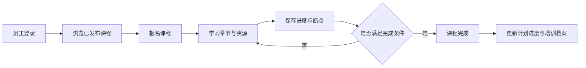

# 企业员工培训系统需求分析说明书

| 项目 | 内容 |
| --- | --- |
| 文档名称 | 企业员工培训系统需求分析说明书 |
| 文档版本 | V1.0 |
| 编制日期 | 2026 年 9 月 21 日 |
| 适用范围 | 员工端 Web、培训管理端 Web、统一后端服务 |
| 需求基线 | 当前仓库的前端培训工作区与 Spring Boot 阶段 4 后端切片 |

## 1. 引言

### 1.1 编写目的

本说明书用于统一产品、业务、开发、测试和验收人员对企业员工培训系统的理解，明确系统边界、用户角色、业务流程、功能需求、数据要求、非功能指标和验收口径，为后续设计、开发、测试、部署和迭代提供依据。

### 1.2 背景与问题

企业培训通常由表格、网盘、即时通信工具和线下考试共同完成，存在课程版本分散、学习过程难以核验、考试成绩无法统一追溯、培训计划执行情况不透明、员工培训档案需要人工汇总等问题。

系统需要把“课程资源—学习进度—考试评价—培训计划—证书档案—统计分析”串成闭环，使员工有统一的学习入口，使培训管理人员可以按组织和计划监管执行结果。

### 1.3 术语

| 术语 | 定义 |
| --- | --- |
| 员工端 | 普通员工使用的学习和考试入口 |
| 管理端 | 培训管理员、人事管理员或超级管理员使用的管理入口 |
| 课程 | 由章节和学习资源组成的培训内容单元 |
| 培训计划 | 在指定时间内向一组员工发布的课程、考试及完成规则集合 |
| 培训任务 | 培训计划发布后为单个员工生成的执行记录 |
| 试卷快照 | 员工开始考试时固化的题目、选项、答案规则和分值 |
| 电子培训档案 | 按员工汇总课程、考试、计划、证书等培训事实的记录 |

## 2. 项目概述

### 2.1 建设目标

1. 建立统一的员工在线学习入口，支持视频、PDF、图片和附件等课程资源。
2. 自动记录章节学习状态、断点位置和完成进度，减少人工登记。
3. 支持题库、试卷、考试任务、自动判分和考试结果查询。
4. 支持培训计划编排、人员分配、进度跟踪和结业判断。
5. 自动形成个人培训档案，并在计划完成后签发唯一证书编号。
6. 为管理人员提供课程、考试、计划和培训数据的汇总分析。
7. 通过身份认证、角色权限、数据隔离、会话控制和审计机制保护培训数据。

### 2.2 系统边界

本期系统包含：

- 员工账号登录、资料维护和会话管理；
- 课程、章节、资源和学习进度；
- 题库、试卷、考试分配、答题和客观题判分；
- 培训计划、课程/考试绑定、人员任务和进度汇总；
- 员工培训档案、管理员统计分析和结业证书；
- 文件访问控制、统一接口返回、错误追踪和基础安全控制。

本期不包含：

- 薪酬、考勤、绩效等完整 HR 业务；
- 直播课堂、实时会议和复杂互动课堂；
- 收费课程、订单和支付；
- 多企业租户隔离；
- 复杂的第三方单点登录；
- 完整的主观题人工阅卷、强防作弊和正式证书 PDF 模板（作为后续迭代）。

### 2.3 设计基线

| 指标 | 基线值 |
| --- | ---: |
| 员工账号 | 5,000 个以内 |
| 日活跃用户 | 1,000 人以内 |
| 普通并发用户 | 300 人 |
| 同时考试人数 | 100 人 |
| 单课程章节数 | 200 个以内 |
| 单文件大小 | 默认 200 MB，生产环境可配置 |
| 访问令牌有效期 | 默认 15 分钟 |
| 刷新会话有效期 | 默认 8 小时 |

## 3. 用户与权限需求

### 3.1 用户角色

| 角色 | 主要目标 | 数据范围 |
| --- | --- | --- |
| 普通员工 | 学习课程、完成培训任务、参加考试、查看档案和证书 | 本人数据及被分配的课程/考试/计划 |
| 培训管理员 | 建设课程、题库和考试，发布培训计划，监管完成情况 | 授权部门及其下级部门 |
| 人事管理员 | 维护组织与员工，查询培训档案和人员报表 | 授权部门及其下级部门 |
| 超级管理员 | 管理角色、权限、系统配置和全部业务数据 | 全部数据 |

实现时可以将培训管理员和人事管理员合并为一个管理账号，但后端仍应保留按操作和数据范围授权的能力。

### 3.2 权限原则

1. 后端是最终权限边界，前端隐藏菜单或按钮不能替代后端校验。
2. 权限由角色授予，数据范围独立配置，支持本人、本部门、本部门及下级部门、自定义部门和全部数据。
3. 员工只能读取和修改自己的资料、学习进度、答卷、档案和证书。
4. 管理员只能访问授权范围内的员工和业务数据。
5. 发布考试、发布计划、批量导出、禁用账号、作废答卷等高风险操作必须记录操作人、时间、对象和结果。

## 4. 业务流程需求

### 4.1 员工学习流程

### 4.2 考试流程

### 4.3 培训计划流程

1. 管理员创建计划草稿，填写名称、分类、起止日期和说明。
2. 绑定已发布课程和已发布考试，并标记必修或选修。
3. 选择目标员工；计划发布时固化人员名单。
4. 系统为每位目标员工创建唯一培训任务。
5. 员工完成课程和考试，系统按事实记录计算任务进度。
6. 任务满足完成条件后标记完成，并生成唯一证书编号。
7. 管理员可查询计划完成率、逾期人员和证书记录。

## 5. 功能需求

优先级定义：P0 为本期必须实现，P1 为重要增强，P2 为后续规划。

### 5.1 认证与个人资料

| 编号 | 优先级 | 需求描述 | 验收要点 |
| --- | :---: | --- | --- |
| FR-AUTH-001 | P0 | 员工使用工号和密码登录 | 成功返回访问令牌和用户角色；错误提示不泄露账号是否存在 |
| FR-AUTH-002 | P0 | 获取 CSRF 令牌并保护写请求 | 所有写请求携带令牌，缺失或错误时拒绝 |
| FR-AUTH-003 | P0 | 使用 HttpOnly Cookie 保存刷新会话 | 刷新令牌不进入前端业务存储；刷新时轮换旧会话 |
| FR-AUTH-004 | P0 | 退出当前会话或全部会话 | 退出后旧刷新会话不可继续换取访问令牌 |
| FR-AUTH-005 | P0 | 查看和修改个人资料 | 携带版本号更新；发生并发修改返回冲突提示 |
| FR-AUTH-006 | P0 | 修改密码 | 密码使用 BCrypt 等单向散列存储；修改后撤销全部刷新会话 |
| FR-AUTH-007 | P1 | 登录失败限流和临时锁定 | 连续失败达到阈值后阻断登录，返回统一错误文案 |

### 5.2 课程与资源

| 编号 | 优先级 | 需求描述 | 验收要点 |
| --- | :---: | --- | --- |
| FR-COURSE-001 | P0 | 员工查看已发布课程并按关键词分页查询 | 员工看不到草稿和已下架课程；分页参数合法 |
| FR-COURSE-002 | P0 | 管理员创建、编辑和发布课程元数据 | 支持标题、简介、分类、难度、时长和状态 |
| FR-COURSE-003 | P0 | 维护课程章节及顺序 | 章节归属正确，排序稳定，发布前至少有有效学习内容 |
| FR-COURSE-004 | P0 | 上传、删除和读取课程资源 | 校验扩展名、文件头、MIME、大小和资源引用 |
| FR-COURSE-005 | P0 | 员工报名课程 | 重复报名幂等；未报名员工不能读取受保护资源 |
| FR-COURSE-006 | P0 | 记录章节进度和最后播放位置 | 重复提交不重复增加记录；进度不能倒退或超过 100% |
| FR-COURSE-007 | P0 | 课程完成后更新课程汇总进度 | 课程完成状态与章节完成事实一致 |
| FR-COURSE-008 | P1 | 支持评价、提问和反馈 | 完成课程后可评价；管理员可查看处理状态 |
| FR-COURSE-009 | P2 | 资源版本、病毒扫描、转码和对象存储 | 替换资源不破坏历史学习记录，下载地址具备时效性 |

### 5.3 题库与考试

| 编号 | 优先级 | 需求描述 | 验收要点 |
| --- | :---: | --- | --- |
| FR-EXAM-001 | P0 | 管理员维护题库 | 当前支持单选、多选、判断；题干、选项和答案完整 |
| FR-EXAM-002 | P0 | 创建试卷草稿并绑定题目 | 题目顺序、题型、分值和解析可查看 |
| FR-EXAM-003 | P0 | 发布前校验试卷 | 题目有效、总分为 100 分、及格分不高于总分 |
| FR-EXAM-004 | P0 | 发布考试并生成员工分配 | 每位员工同一试卷只有一条有效分配记录 |
| FR-EXAM-005 | P0 | 开始考试时生成不可变快照 | 后续修改题库不影响已开始答卷 |
| FR-EXAM-006 | P0 | 员工答题、保存和交卷 | 只能在截止日期前开始；交卷接口幂等 |
| FR-EXAM-007 | P0 | 客观题服务端判分 | 判分基于快照答案；重复提交返回同一结果 |
| FR-EXAM-008 | P1 | 倒计时和超时交卷 | 以服务端时间为准，过期答卷不能继续提交 |
| FR-EXAM-009 | P1 | 批量导入题目、随机组卷、错题练习 | 导入先预检；随机题目不重复且题量不足时阻止发布 |
| FR-EXAM-010 | P2 | 主观题阅卷与防作弊 | 支持人工评分、复核、异常行为记录和策略配置 |

### 5.4 培训计划

| 编号 | 优先级 | 需求描述 | 验收要点 |
| --- | :---: | --- | --- |
| FR-PLAN-001 | P0 | 创建和查看培训计划草稿 | 计划包含名称、分类、日期、说明和状态 |
| FR-PLAN-002 | P0 | 绑定课程和考试 | 只能绑定已发布对象；同一对象在计划内不可重复 |
| FR-PLAN-003 | P0 | 发布计划并生成任务 | 发布时固化目标员工名单并保证去重 |
| FR-PLAN-004 | P0 | 员工查看本人计划和计划明细 | 未分配员工不可读取计划 |
| FR-PLAN-005 | P0 | 根据课程完成和考试通过刷新进度 | 进度由服务端事实计算，前端不得直接改写 |
| FR-PLAN-006 | P0 | 计划完成后自动签发证书 | 同一计划与员工组合只能生成一张有效证书 |
| FR-PLAN-007 | P1 | 计划变更、终止、归档和逾期提醒 | 记录版本、变更人和影响范围 |

### 5.5 培训档案与数据分析

| 编号 | 优先级 | 需求描述 | 验收要点 |
| --- | :---: | --- | --- |
| FR-ARCHIVE-001 | P0 | 员工查看个人培训档案 | 展示课程、考试、计划、最近记录和统计汇总 |
| FR-ARCHIVE-002 | P0 | 管理员查看汇总分析 | 至少展示启用员工数、课程完成率、考试通过率和计划完成率 |
| FR-ARCHIVE-003 | P0 | 查询证书 | 员工仅能查看本人；管理员查看授权范围 |
| FR-ARCHIVE-004 | P1 | 导出培训档案和统计报表 | 文件包含数据范围、生成时间和操作人，下载受权限保护 |
| FR-ARCHIVE-005 | P1 | ECharts 图表分析 | 支持按时间、部门、课程和计划切换统计维度 |

### 5.6 组织与员工管理

| 编号 | 优先级 | 需求描述 | 验收要点 |
| --- | :---: | --- | --- |
| FR-ORG-001 | P1 | 部门树维护 | 支持新增、编辑、排序、停用和负责人设置 |
| FR-ORG-002 | P1 | 员工新增、编辑、启用、停用和解锁 | 工号唯一；离职人员不能接收新任务 |
| FR-ORG-003 | P1 | 员工批量导入和失败报告 | 支持模板预检、逐行错误原因和幂等处理 |
| FR-ORG-004 | P1 | 角色与数据范围配置 | 不允许取消系统最后一个超级管理员 |

## 6. 数据需求

### 6.1 核心实体

| 实体 | 关键属性 | 关系 |
| --- | --- | --- |
| 部门 | id、名称、编码、状态 | 一个部门包含多个员工 |
| 用户 | 工号、姓名、部门、角色、状态、版本号 | 用户拥有多个会话和培训事实 |
| 会话 | 用户、刷新令牌哈希、过期时间、撤销时间 | 用于刷新会话轮换和退出 |
| 课程 | 标题、分类、状态、时长、版本号 | 一门课程包含多个章节 |
| 章节 | 课程、标题、排序、内容、时长 | 一个章节包含多个资源 |
| 资源 | 章节、类型、文件元数据、存储位置 | 受课程发布状态和报名关系保护 |
| 学习进度 | 用户、课程/章节、进度、最后位置、完成时间 | 用户与课程之间形成报名和进度事实 |
| 题目 | 类型、题干、选项、答案、解析、难度、状态 | 题目可被多个试卷引用 |
| 试卷 | 标题、时长、及格分、截止日期、状态 | 试卷包含快照题目并分配给用户 |
| 答卷 | 试卷、用户、次数、状态、成绩、提交时间 | 答卷包含多条答案 |
| 培训计划 | 标题、日期、状态、版本号 | 绑定课程、试卷和员工任务 |
| 证书 | 编号、计划、用户、签发时间、撤销时间 | 计划与用户唯一 |

### 6.2 数据规则

1. 工号、部门编码、证书编号在相应业务范围内唯一。
2. 课程、试卷、计划发布后保留版本和发布时间，历史培训事实不可被覆盖。
3. 删除采用“可追溯优先”原则；被引用的课程、试卷、计划和证书不得物理删除。
4. 学习进度、答卷成绩和档案汇总分层保存，档案不能直接覆盖原始事实。
5. 所有时间统一由服务端生成并按统一时区存储，前端负责本地化展示。

## 7. 接口与交互需求

### 7.1 接口约定

- 接口前缀：`/api/v1`。
- 成功响应：`{ code: "OK", message, data, traceId, timestamp }`。
- 分页响应包含 `list`、`pageNo`、`pageSize` 和 `total`。
- 错误响应不得返回 SQL、JWT、堆栈和密码等敏感信息；使用 `traceId` 关联服务日志。
- 写操作需要 CSRF 令牌；业务上可能重复提交的接口必须幂等。

### 7.2 当前主要接口范围

| 业务 | 接口示例 |
| --- | --- |
| 认证 | `/api/v1/auth/csrf`、`/login`、`/refresh`、`/logout` |
| 个人资料 | `/api/v1/me`、`/me/profile`、`/me/password` |
| 员工课程 | `/api/v1/employee/courses` 及报名、进度接口 |
| 管理课程 | `/api/v1/admin/courses`、章节和资源接口 |
| 考试 | `/api/v1/admin/questions`、`/admin/exams`、`/employee/exams` |
| 培训计划 | `/api/v1/admin/plans`、`/employee/plans` |
| 档案分析 | `/api/v1/employee/archive`、`/admin/analytics` |
| 证书 | `/api/v1/employee/certificates`、`/admin/certificates` |

### 7.3 交互要求

1. 页面显示加载、空数据、失败和重试状态。
2. 发生 401 时仅对当前请求执行一次会话刷新和重试，避免无限重试。
3. 发生 409 版本冲突时提示用户刷新数据后重新编辑，不能静默覆盖他人修改。
4. 移动端宽度约 390 px 时主要页面可用，不出现整体横向滚动。
5. 资源预览按类型选择视频播放器、PDF 内嵌预览、图片预览或附件下载。

## 8. 非功能需求

### 8.1 安全性

- 密码采用 BCrypt 等单向散列，禁止明文存储。
- 访问令牌放在运行时内存，刷新令牌使用 HttpOnly、SameSite Cookie。
- 对文件扩展名、MIME、文件头、大小和访问权限进行服务端校验。
- 后端强制执行角色和数据范围；员工不能通过修改 URL 或参数读取他人数据。
- 登录失败限流，敏感操作写入审计日志。
- 日志不得记录密码、完整令牌和敏感个人信息。

### 8.2 性能与可用性

- 常规列表查询在基线数据量下 2 秒内返回，分页查询不得一次加载全部数据。
- 学习进度和答卷提交在网络重试下保持幂等。
- 文件上传、转换和报表导出应支持异步化扩展，避免阻塞主请求。
- 数据库迁移使用 Flyway 管理，应用启动失败不得破坏已有数据。
- 生产资源存储应从本机目录扩展到对象存储，并配合病毒扫描和临时签名地址。

### 8.3 兼容性与可维护性

- 支持 Chrome、Edge、Safari、Firefox 等现代浏览器的主流版本。
- 前后端分离，前端使用 Vue 3、TypeScript、Vite，后端使用 Spring Boot、Java 17、MySQL。
- 接口、数据库迁移、权限编码和错误码保持可追踪，新增需求应补充对应验收项。

## 9. 验收标准

### 9.1 P0 主路径

1. 员工可登录、刷新会话、退出，并只能看到本人数据。
2. 管理员可创建课程、章节和资源；发布后员工可报名、学习和完成章节。
3. 管理员可维护题库、创建 100 分试卷、发布考试；员工可开始、答题、交卷并获得服务端成绩。
4. 管理员可绑定课程和考试并发布计划；系统为目标员工生成唯一任务。
5. 员工完成计划后，计划进度、个人档案和证书记录同步更新。
6. 重复报名、重复提交进度、重复交卷和重复发布不会产生重复业务事实。
7. 草稿、未分配考试、未报名资源和越权数据均不可被员工访问。

### 9.2 质量门禁

- 后端单元和集成测试通过，数据库迁移可在隔离库完整执行。
- 前端 `typecheck` 和 `build` 通过。
- 业务检查覆盖题型判分、快照冻结、幂等交卷、名单去重、权限范围和版本冲突。
- 完成桌面和移动端关键页面验证，记录浏览器、分辨率和已知限制。
- 生产上线前完成备份恢复演练、日志脱敏检查、文件访问检查和权限审计。

## 10. 当前实现状态与后续迭代

### 10.1 当前已落地

仓库阶段 4 后端已经覆盖认证、课程与资源、学习报名与进度、题库与客观题考试、培训计划、个人档案、管理员分析和证书查询的主路径；前端 `connected.html` 提供真实接口联调入口。数据库迁移已包含组织用户、课程、学习、考试、计划和证书等核心表。

### 10.2 后续优先项

1. 完善组织、员工、角色和数据权限管理接口。
2. 增加题目批量导入、自动保存、人工阅卷和成绩复核。
3. 增加正式证书模板、PDF 生成、撤销和验证链接。
4. 增加对象存储、病毒扫描、视频转码、临时下载地址和异步任务。
5. 增加更细粒度的部门/时间维度统计、导出和通知提醒。
6. 使用 Redis 或同类共享基础设施替换单实例限流和会话扩展方案。

## 11. 风险与应对

| 风险 | 影响 | 应对措施 |
| --- | --- | --- |
| 课程资源体积大或格式复杂 | 上传失败、预览不一致 | 限制大小和类型，接入对象存储、转码和异步处理 |
| 多管理员同时编辑 | 数据被覆盖 | 使用版本号和 409 冲突处理，发布操作记录审计 |
| 前端伪造学习时长 | 培训结果失真 | 服务端校验进度、心跳间隔和可接受跳时范围 |
| 题库修改影响历史考试 | 成绩无法追溯 | 开考时保存不可变试卷快照 |
| 越权读取档案或资源 | 隐私和合规风险 | 服务层强制校验用户、分配关系、角色和数据范围 |
| 单实例运行限制扩展 | 高并发下限流和会话不一致 | 生产环境采用共享会话、共享限流和集中日志 |

## 12. 需求追踪说明

本说明书中的 FR 编号可作为产品、接口、数据库、前端页面和测试用例的追踪键。后续每个需求变更至少需要同步更新：需求编号、业务规则、接口契约、数据迁移、测试用例和验收记录。当前仓库已有的开发文档、前端业务检查脚本和后端测试可作为本说明书的实现佐证，但“后续迭代”部分不能在未完成接口、权限和测试前标记为已交付。

